# Networking Fundamentals

When you open a site, your device does not speak directly to a distant server. It joins a local network, passes data through other networks, and receives a reply. This chapter builds that picture one piece at a time.

## Why? Here's How

- In the 1960s, researchers wanted computers at different institutions to share resources. Resilient communication also mattered during the Cold War.
- The U.S. Advanced Research Projects Agency funded **ARPANET** (**Advanced Research Projects Agency Network**), an important precursor to the internet.
- Packet switching allowed messages to be divided into pieces and sent across a network. Networks with alternative routes can keep working when a link or node fails; resilience depends on those alternative routes existing.

  Build a network where, if one node goes down, the data finds another route and still gets through.

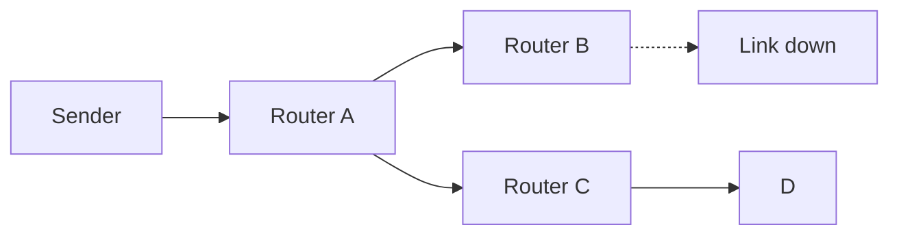

**How to read the diagram:** The sender passes data to Router A. If the route through Router B is unavailable, Router A can use Router C to reach the same receiver.

**Remember it:** A road closure does not stop a delivery if another road reaches the same address.

### October 29, 1969

The first host-to-host ARPANET message went from UCLA to **Stanford Research Institute (SRI)**, a separate organization near Stanford University.

The message was **"LOGIN"**, but the system crashed after the first two letters.

> The first attempt delivered **"LO"** before the SRI host crashed. A later attempt completed the login.

**Remember it:** It was like starting to type “LOGIN” into a remote computer and getting only “LO” through before that computer stopped.

### The 1970s and 1980s

- ARPANET expanded, but it was limited to the military and research institutions.
- Universities started connecting.
- Scientists started sharing data.
- The network grew.

**Remember it:** Individual research sites became connected like university libraries joining a shared lending network.

### 1983

- ARPANET adopted a new communication standard called **TCP/IP**.
- This gave interconnected networks a common protocol suite. Compatible networks could communicate across organizational boundaries.

**Remember it:** Different postal companies can exchange parcels when they agree on addresses and handoff rules.

## Basic Terminologies

### Computer Network

A **computer network** is a set of connected devices that exchange data and share resources through agreed rules called protocols.

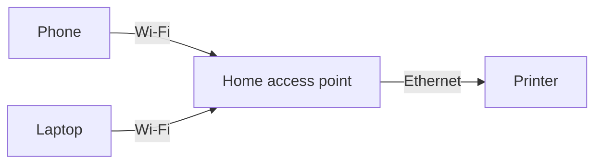

**How to read the diagram:** The phone and laptop join the home access point over Wi-Fi. The printer joins by Ethernet, so the devices can communicate on the same local network.

**Remember it:** A home Wi-Fi network lets your laptop send a document to a printer.

### Host

A **host** is an endpoint on a network that can send or receive data. In an IP network, a host commonly has an IP address; routers also have IP addresses, so an address alone does not define a host.

Examples:

- PC
- Laptop
- Server
- Mobile

**Remember it:** Hosts are the people sending and receiving letters; routers are the sorting offices along the way.

### Networking

Sharing data and resources in a network is known as **networking**.

**Remember it:** Two office computers sharing a printer are networking even without internet access.

## Internet

At its core, the internet is a **network of networks**.

- Your home has a Wi-Fi network.
- Your office has a network.
- Your college has a network.
- Your phone company has a network.
- Data centers have massive networks.
- ISPs (Internet Service Providers) have networks.

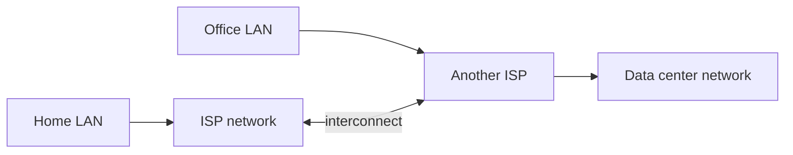

**How to read the diagram:** Home and office networks connect through their ISPs. Those provider networks link to other networks, including the network that hosts a data center.

Here is something most developers never think about:

> The internet is physical. It consists of cables, hardware, and buildings.

**Remember it:** The internet is the connected road system; a website is one destination reached using it.

## The Broader Picture of the Internet

- Nobody owns the internet; everybody owns a piece of it.
- Your ISP, such as Jio or Airtel, owns cables and equipment that connect your home to a wider network.
- A data center company owns servers and infrastructure.

No single organization owns the entire internet. Operators own and maintain different networks and agree on ways to exchange traffic.

**Remember it:** Many railway companies own different tracks, but passengers can still travel across the larger rail system.

## Submarine Cables

- Your phone is connected to Wi-Fi.
- The Wi-Fi connects to your router,
- and the router connects to your ISP.

A route from India to a U.S. server may cross **submarine fiber-optic cables**. The exact route varies; it may pass through several networks and landing stations, and not every international request crosses an ocean.

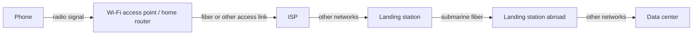

**How to read the diagram:** Follow the request from the phone to home Wi-Fi, the ISP, a coastal landing station, an undersea cable, and finally the data center. The response travels back through networks too; its route need not be identical.

### Engineering, Not Magic

When you open a website hosted in the U.S., there is a very real chance that your request travels from your device, through your ISP, down to a coastal landing station, through an undersea cable across the ocean, and arrives at a data center on the other side.

**Remember it:** Your request is a parcel carried by local streets, highways, and an overseas shipping route. The reply makes a return journey, possibly by a different path.

## WWW vs. Internet

Whenever we talk about the internet, we think about browsing websites, watching videos, and using apps. However, that is not the internet itself; it is something built on top of it.

It is called the **WWW (World Wide Web)**.

The **internet** is a transport system: a global network that moves data from one place to another. It moves messages, videos, files, audio, and anything else that can be represented as data.

The WWW is one specific application that runs on top of the internet.

**Remember it:** The internet is the road network; the Web is a collection of pages and links you reach over those roads. Email uses the same roads but is a different service.

### The Birth of the World Wide Web

**Tim Berners-Lee** proposed the World Wide Web at CERN in **1989** and implemented its first browser and server in **1990**. The Web became accessible beyond CERN in **1991**.

The idea was to create a simple system of interlinked documents that anyone could access over the internet using a browser.

He invented three things to make it work:

1. **HTML (HyperText Markup Language)**
   - A language used to write and structure documents.
2. **HTTP (Hypertext Transfer Protocol)**
   - A protocol that defines how those documents are requested and delivered over the internet.
3. **URL (Uniform Resource Locator)**
   - An address that identifies where to find a web resource.

The combination of these three gives us a massive collection of pages linked to each other, accessible through a browser and delivered over the internet.

> **Summary:** The internet is the infrastructure—the hardware. The WWW is a service that runs on that infrastructure.

**Remember it:** HTML is the page, HTTP is the request-and-response rule, and a URL is the address written on the envelope.

## Client-Server Architecture

A **client** is a program or device that makes a request, such as a browser, mobile app, or terminal.

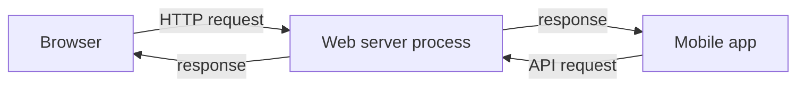

**How to read the diagram:** Both the browser and mobile app act as clients. Each sends a request to the server process, which returns a response to that client.

A **server** is a program, or the machine running it, that listens for requests and responds.

A server is simply a computer running software that listens on a port, waits for incoming requests, and sends back responses. Your laptop can also be a server.

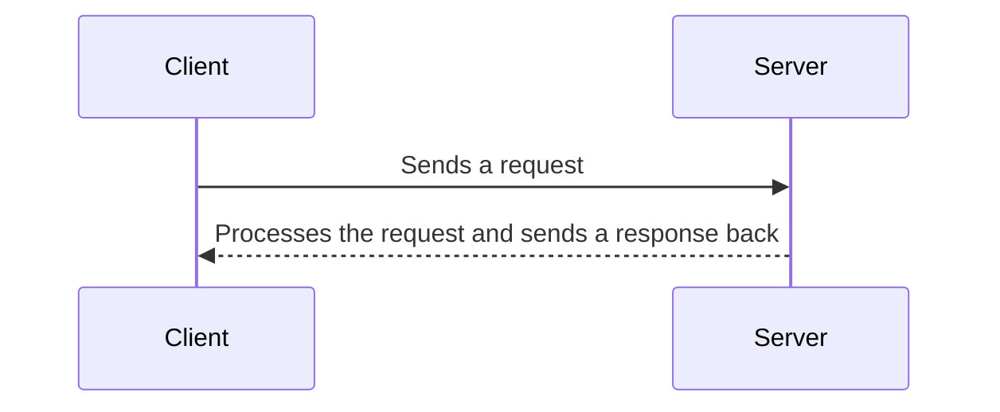

**How to read the diagram:** Read from top to bottom: the client asks, the server processes, and the server replies. Another client can make its own request to the same server.

A server may handle many clients at once; its capacity depends on hardware, software, and workload.

**Remember it:** A client is a restaurant customer placing an order; the server is the kitchen that receives it and returns the meal.

## Types of Networks

Not all connections in the following path belong to the same type of network:

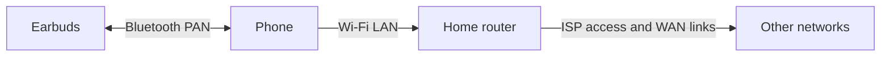

**How to read the diagram:** Earbuds and phone form a personal network. The phone reaches the home router over a local network; the router reaches wider networks through the ISP.

They have:

- Different names
- Different scales
- Different purposes

The four common types are **PAN, LAN, MAN, and WAN**.

These are descriptions of scope, not four mandatory stages that every packet must cross.

### PAN — Personal Area Network

A **Personal Area Network (PAN)** is a network of devices around a single person.

Examples:

- Connecting your phone to your earbuds
- Syncing a smartwatch with your phone
- Connecting personal devices over a tiny range

**Remember it:** Your earbuds, watch, and phone are a tiny personal circle.

### LAN — Local Area Network

A **Local Area Network (LAN)** covers a relatively small area, such as:

- A home
- An office building
- A campus

It is used for sharing resources such as printers and files, and for communication between devices.

**Remember it:** The devices in one office can share a printer without leaving the office LAN.

### MAN — Metropolitan Area Network

A **Metropolitan Area Network (MAN)** is the bigger sibling of a LAN.

- It covers a large geographical area, typically spanning a city or metropolitan area.
- It connects multiple LANs or network segments within the same region.
- It is used by businesses, educational institutions, and government organizations.

**Remember it:** A university's separate campus LANs connected across one city resemble a MAN.

### WAN — Wide Area Network

A **Wide Area Network (WAN)** covers wide geographical areas, including multiple cities, countries, or even continents.

- The internet itself is the largest example of a WAN.
- Large companies have their own private WANs connecting offices in cities such as Mumbai, Bangalore, New York, and London into one unified corporate network.
- Banks and airlines also use WANs.

**Remember it:** A bank linking its Mumbai and London branches needs a WAN.

> The internet interconnects many networks. PAN, LAN, MAN, and WAN are useful scale labels; they do not form a strict nesting rule.

## Network Topologies

**Topology** means the way devices are arranged and connected to each other.

These sketches show connection patterns, not the full behavior of every protocol. Physical and logical topologies can differ.

### Bus Topology

All devices are connected to a single cable called the **bus**.

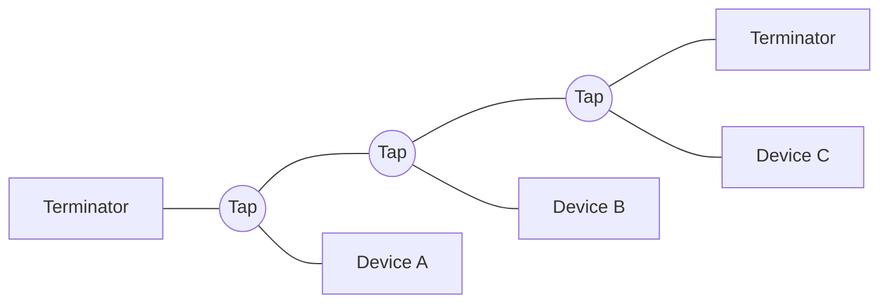

**How to read the diagram:** The long horizontal cable is the shared bus. Each device attaches at a tap, and terminators sit at both ends of the cable.

**Remember it:** Several people speak over one shared hallway. A broken main cable can affect everyone. This is a classic shared-medium design, not the usual modern switched Ethernet layout.

### Ring Topology

Each device is connected to the next device in a circular loop, forming a ring.

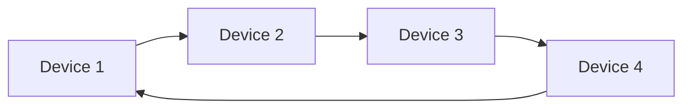

**How to read the diagram:** Each device connects to the next until the last connects back to the first. The arrows show one possible direction in which data moves around this ring.

In a simple unidirectional ring, data travels around the loop through each device. Some ring designs have different behavior or redundant paths.

**Remember it:** A note passed around a circle of people reaches the next person in sequence.

### Star Topology

All devices are connected to a central hub or switch.

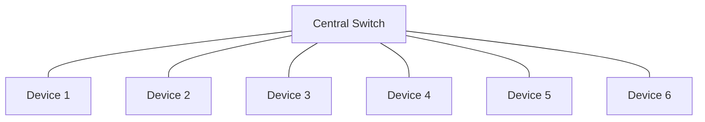

**How to read the diagram:** Every device has its own connection to the central switch. A message between two devices passes through that central point.

The switch acts as the central point of connection and forwards Ethernet frames to the appropriate port. A hub instead repeats incoming signals to other ports.

**Remember it:** Each desk has its own cable to the office switch. One desk cable failing need not disconnect the others.

### Mesh Topology

In a **full mesh**, each device has a direct connection to every other device. A **partial mesh** has several alternative routes without requiring every possible connection.

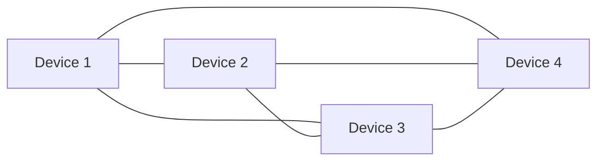

**How to read the diagram:** Each of the four devices has a direct line to the other three. If one line fails, connected devices can still have an alternative route through another device.

It forms a network of interconnected paths, providing multiple routes for data to travel.

**Remember it:** A city with several cross streets offers alternative routes when one road closes. Real backbone networks often use partial meshes.

### Tree Topology

A **tree topology** is a hierarchical network layout with a central level branching into smaller groups. It can combine star-shaped branches with a shared backbone.

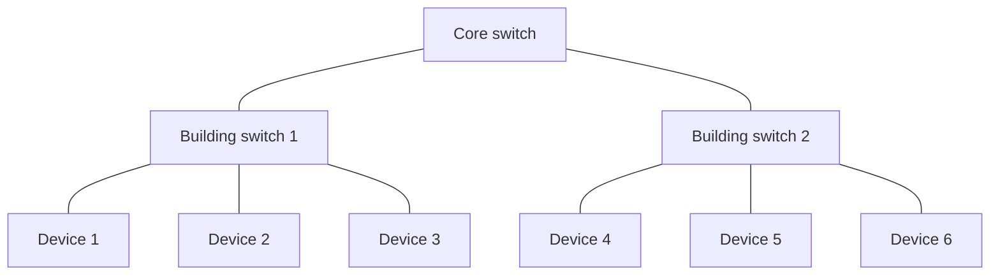

**How to read the diagram:** Start at the core switch at the top, then follow a branch to a building switch and finally to an individual device. This branching shape is the tree.

**Remember it:** A campus core switch connects building switches, which connect individual computers. The branches form a hierarchy.

## Sources and further reading

- [Computer History Museum: ARPANET in the 1960s](https://www.computerhistory.org/internethistory/1960s/)
- [Computer History Museum: the first ARPANET transmission](https://computerhistory.org/press-releases/museum-celebrates-arpanet-anniversary/)
- [Computer History Museum: TCP/IP adoption in 1983](https://www.computerhistory.org/internethistory/1980s/)
- [CERN: a short history of the Web](https://home.cern/science/computing/the-birth-of-the-web/short-history-web/)
