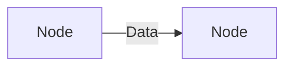
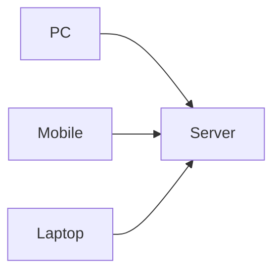
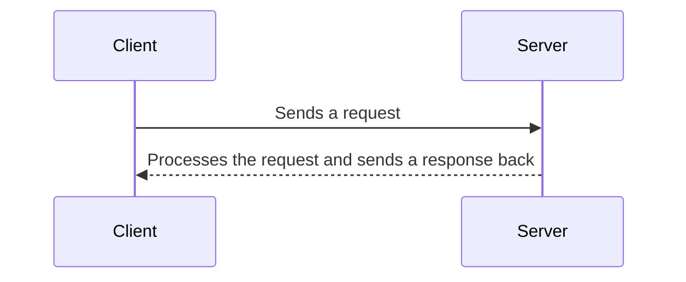
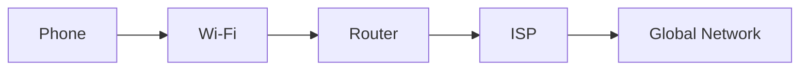
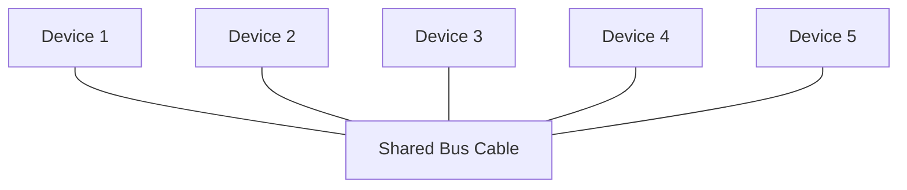
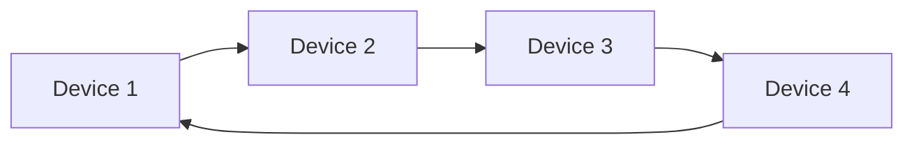
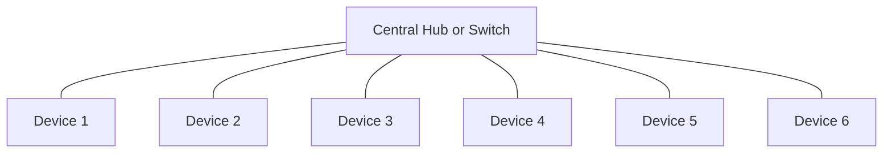
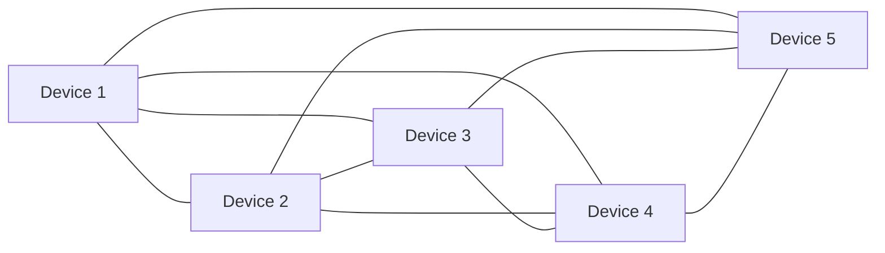
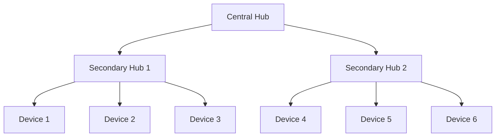

# Networking Fundamentals

## Why? Here's How

- In the 1960s, at the peak of the Cold War, the U.S. military was concerned that if the Soviet Union destroyed one communication center, the entire U.S. military communication system would go down.
- To tackle this problem, the internet came alive.
- In 1969, the U.S. Department of Defense funded a project called **ARPANET** (**Advanced Research Projects Agency Network**).
- The goal was very simple: if any one of the nodes went down, communication should still continue.

  Build a network where, if one node goes down, the data finds another route and still gets through.

### October 29, 1969

The first-ever message was sent over ARPANET between two computers at UCLA and Stanford.

The message was **"LOGIN"**, but the system crashed after the first two letters.

> The first-ever message sent over what became the internet was **"LO"**.

### The 1970s and 1980s

- ARPANET expanded, but it was limited to the military and research institutions.
- Universities started connecting.
- Scientists started sharing data.
- The network grew.

### 1983

- ARPANET adopted a new communication standard called **TCP/IP**.
- This was the moment the internet got its universal language.
- Any computer, anywhere, could now connect and communicate.

## Basic Terminologies

### Computer Network

A **computer network** is a digital communication medium that allows nodes to share resources.

### Host

A **host** is any device that gets an IP address.

Examples:

- PC
- Laptop
- Server
- Mobile

### Networking

Sharing data and resources in a network is known as **networking**.

## Internet

At its core, the internet is a **network of networks**.

- Your home has a Wi-Fi network.
- Your office has a network.
- Your college has a network.
- Your phone company has a network.
- Data centers have massive networks.
- ISPs (Internet Service Providers) have networks.

Here is something most developers never think about:

> The internet is physical. It consists of cables, hardware, and buildings.

## The Broader Picture of the Internet

- Nobody owns the internet; everybody owns a piece of it.
- Your ISP, such as Jio or Airtel, owns cables and equipment that connect your home to a wider network.
- A data center company owns servers and infrastructure.

## Submarine Cables

- Your phone is connected to Wi-Fi.
- The Wi-Fi connects to your router,
- and the router connects to your ISP.

Your ISP in India connects to a server located in the U.S. through **submarine cables**.

### Engineering, Not Magic

When you open a website hosted in the U.S., there is a very real chance that your request travels from your device, through your ISP, down to a coastal landing station, through an undersea cable across the ocean, and arrives at a data center on the other side.

## WWW vs. Internet

Whenever we talk about the internet, we think about browsing websites, watching videos, and using apps. However, that is not the internet itself; it is something built on top of it.

It is called the **WWW (World Wide Web)**.

The **internet** is a transport system: a global network that moves data from one place to another. It moves messages, videos, files, audio, and anything else that can be represented as data.

The WWW is one specific application that runs on top of the internet.

### The Birth of the World Wide Web

In 1991, **Tim Berners-Lee** built the World Wide Web.

The idea was to create a simple system of interlinked documents that anyone could access over the internet using a browser.

He invented three things to make it work:

1. **HTML (HyperText Markup Language)**
   - A language used to write and structure documents.
2. **HTTP (Hypertext Transfer Protocol)**
   - A protocol that defines how those documents are requested and delivered over the internet.
3. **URL (Uniform Resource Locator)**
   - A system that gives every document a unique address so anyone can find it.

The combination of these three gives us a massive collection of pages linked to each other, accessible through a browser and delivered over the internet.

> **Summary:** The internet is the infrastructure—the hardware. The WWW is a service that runs on that infrastructure.

## Client-Server Architecture

A **client** is anything that makes a request, such as a browser, mobile app, or terminal.

A **server** is anything that listens for requests and responds to them.

A server is simply a computer running software that listens on a port, waits for incoming requests, and sends back responses. Your laptop can also be a server.

A single server can handle thousands—and sometimes millions—of client requests simultaneously.

## Types of Networks

Not all connections in the following path belong to the same type of network:

They have:

- Different names
- Different scales
- Different purposes

The four common types are **PAN, LAN, MAN, and WAN**.

### PAN — Personal Area Network

A **Personal Area Network (PAN)** is a network of devices around a single person.

Examples:

- Connecting your phone to your earbuds
- Syncing a smartwatch with your phone
- Connecting personal devices over a tiny range

### LAN — Local Area Network

A **Local Area Network (LAN)** covers a relatively small area, such as:

- A home
- An office building
- A campus

It is used for sharing resources such as printers and files, and for communication between devices.

### MAN — Metropolitan Area Network

A **Metropolitan Area Network (MAN)** is the bigger sibling of a LAN.

- It covers a large geographical area, typically spanning a city or metropolitan area.
- It connects multiple LANs or network segments within the same region.
- It is used by businesses, educational institutions, and government organizations.

### WAN — Wide Area Network

A **Wide Area Network (WAN)** covers wide geographical areas, including multiple cities, countries, or even continents.

- The internet itself is the largest example of a WAN.
- Large companies have their own private WANs connecting offices in cities such as Mumbai, Bangalore, New York, and London into one unified corporate network.
- Banks and airlines also use WANs.

> The internet is a collection of all these networks: PAN, LAN, MAN, and WAN.

## Network Topologies

**Topology** means the way devices are arranged and connected to each other.

### Bus Topology

All devices are connected to a single cable called the **bus**.

It is like a group chat where everyone can see and participate in the conversation.

### Ring Topology

Each device is connected to the next device in a circular loop, forming a ring.

Data travels around the ring in one direction, passing through each device.

### Star Topology

All devices are connected to a central hub or switch.

The hub acts as the central point of connection, and data flows through it to reach the intended devices.

### Mesh Topology

Each device is connected to every other device in the network.

It forms a network of interconnected paths, providing multiple routes for data to travel.

### Tree Topology

A **tree topology** is a hierarchical network topology that combines elements of bus and star topologies.

It is like a family tree where everyone has their place in the hierarchy.
