# Network Models

Network models give us a way to explain the same journey at different levels: what the app asks for, how the two endpoints communicate, how packets cross networks, and how each local link carries them.

## Why Do We Need Network Models?

Suppose you are watching something on YouTube. You open the application on your phone, and the request:

1. Leaves your device.
2. Travels through Wi-Fi.
3. Crosses the internet.
4. Reaches a server in a data center.
5. Gets processed.
6. Returns with the requested data.

Your phone may be made by Apple, the server may be running Linux, the router in your house may come from a completely different manufacturer, and your ISP may use different equipment again.

They can understand each other because they implement compatible **protocols and standards**. Models organize those functions so we can learn and troubleshoot them.

**Remember it:** People using different brands of phones can call each other because the networks agree on common signaling rules.

### The Problem in the Early Days

In the early days, every company built its own system with:

- Its own cables
- Its own rules
- Its own method of sending data

Proprietary systems could not always communicate with each other.

The networking industry needed a common language—not only for cables and signals, but for every aspect of how data moves from one place to another.

That is why we have **layered network models**, where each layer has a different responsibility and uses a specific set of protocols.

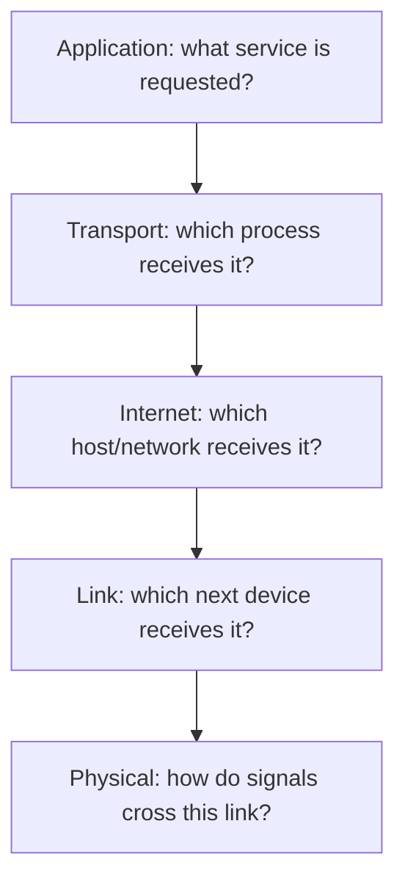

**How to read the diagram:** Follow the request downward. Each layer has a smaller job: choose the application service, reach its process, address the destination, cross the local link, and send signals.

## Who Defines Networking Standards?

Networking standards are developed by independent standards organizations.

### IEEE

The **IEEE (Institute of Electrical and Electronics Engineers)** develops many technologies used on local area networks, including:

- Ethernet
- Wi-Fi

**Remember it:** IEEE defines local road rules such as how Ethernet and Wi-Fi links work.

### IETF

The **IETF (Internet Engineering Task Force)** is an open standards organization that defines many of the protocols used on the internet.

**Remember it:** IETF specifications help independently built hosts agree on IP, TCP, and other internet protocols.

## OSI Model

The **OSI (Open Systems Interconnection) model** is a seven-layer reference framework for describing network communication. Real internet protocols do not always map neatly to one OSI layer.

The model consists of seven layers:

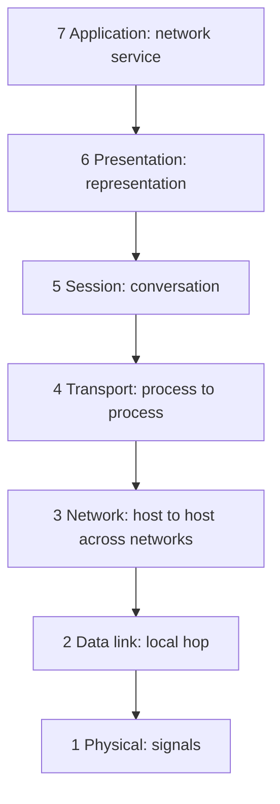

**How to read the diagram:** The seven OSI layers are stacked from the application at the top to physical signals at the bottom. A sender moves data downward; a receiver interprets it upward.

### Innovation and Flexibility

The layered design provides the following benefits:

- Each layer can be improved separately.
- Innovations in physical media, such as faster cables, do not affect the other layers.
- It allows easier upgrades while maintaining compatibility.

**Remember it:** Replacing the road surface need not change the address on a parcel or the message inside it.

## The Seven OSI Layers

### 7. Application Layer

The application layer is where network-facing application protocols serve programs and, indirectly, their users.

- Application protocols provide services to software. A browser uses HTTP or HTTPS at this layer; the browser itself spans more than one conceptual function.

**Remember it:** Asking a website for a page is the application-level request.

### 6. Presentation Layer

The presentation layer ensures that data is in a usable and correct format.

Its responsibilities include:

- Encryption and decryption
- Compression and decompression
- Translation between data formats
- Converting data into a machine-representable format

For example, translating between ASCII and EBCDIC is a form of data translation.

In practical TCP/IP systems, these tasks are often handled by application protocols and libraries rather than a distinct presentation protocol.

**Remember it:** Translating a letter into a language the recipient can read resembles data representation; sealing it resembles encryption.

### 5. Session Layer

The session layer manages communication sessions between systems.

Its responsibilities include:

- Creating and maintaining sessions
- Managing the session of communication
- Coordinating a conversation and, in some systems, checkpoints or recovery

Authentication and authorization can occur at different layers in real systems; they are not exclusive session-layer jobs.

**Remember it:** A video call has a beginning, an active conversation, and an end.

### 4. Transport Layer

The transport layer carries data between application processes on different hosts. Its guarantees depend on the chosen protocol: TCP adds ordering, retransmission, and flow control; UDP provides a simpler datagram service.

Common protocols include:

- TCP
- UDP

In a TCP example, important responsibilities are:

1. Segmentation
2. Flow control
3. Error control

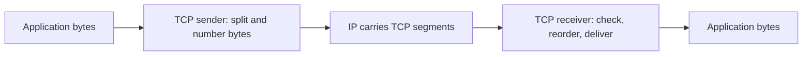

**How to read the diagram:** TCP splits an application's byte stream into segments for transmission. The receiver uses TCP's sequence information to put the bytes back in order for the application.

#### Segmentation

- Data received from the upper layer is divided into smaller units called **segments**.
- TCP segments contain source and destination ports plus sequence information. UDP datagrams have ports but no TCP-style sequence number or reassembly guarantee.

**Remember it:** Large documents can be sent in numbered envelopes, then put back in order on arrival. That describes TCP, not every transport protocol.

#### Flow Control

Flow control controls the amount of data being transferred so that the receiver is not overwhelmed.

**Remember it:** A sender pauses when the receiver's inbox is full. TCP uses a receive window for this.

#### Error Control

Transport checksums detect corruption. TCP can retransmit missing data; UDP itself does not promise retransmission.

**Remember it:** If a numbered envelope is missing, a reliable courier asks for it again.

### 3. Network Layer

The network layer is responsible for:

- Logical addressing through IP addresses
- Routing: determining a next hop toward a destination
- Forwarding: sending a packet through an outgoing interface toward that next hop

Load balancing can use network-layer techniques, but it is not a defining responsibility of the layer.

**Remember it:** IP addresses are destination addresses; routers choose the next road toward them. IP itself does not guarantee delivery.

### 2. Data Link Layer

The primary functions of the data link layer include:

- Framing
- Physical addressing
- Error detection (and, for some link technologies, correction or local retransmission)
- Rules for accessing the local medium

A frame includes:

- Source MAC address
- Destination MAC address

A conventional Ethernet **MAC address** is 48 bits, commonly written as 12 hexadecimal digits (for example, `02:11:22:33:44:55`). Some networks also use other address sizes or temporary randomized addresses.

**Remember it:** A MAC address helps deliver a frame on the current local link; the destination MAC can change at a router while the packet continues toward its IP destination.

### 1. Physical Layer

The physical layer represents the actual physical medium, such as Ethernet cables or wireless signals.

- Network interfaces encode data into signals for the medium.
- It transmits data as a stream of bits.
- Bits are carried using optical, electrical, or radio signals.

**Remember it:** Copper sends electrical changes, fiber sends light, and Wi-Fi sends radio waves.

## Encapsulation and Decapsulation

As data moves from the client down the network stack, each layer prepares it for transmission:

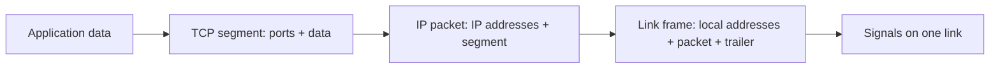

**How to read the diagram:** Move left to right. Application data gains a TCP header, then an IP header, then a local-link frame. The physical layer sends that frame as signals across one link.

On the server side, the process happens in reverse:

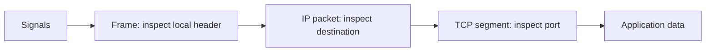

**How to read the diagram:** On receipt, move left to right through the reverse steps: interpret signals, read the frame, read the IP packet, read the transport segment, and deliver the application data.

**Remember it:** Sending adds addressed envelopes around the message. Receiving opens them from the outside inward. Encryption, when used, is handled by a specific protocol such as TLS, not automatically by every OSI stack.

## TCP/IP Model

The **TCP/IP suite** is the family of protocols used for internet communication. The model groups their functions. Some books use four layers, combining data link and physical into one **link** layer; these notes use a five-layer teaching version.

In the five-layer version, it contains the following layers:

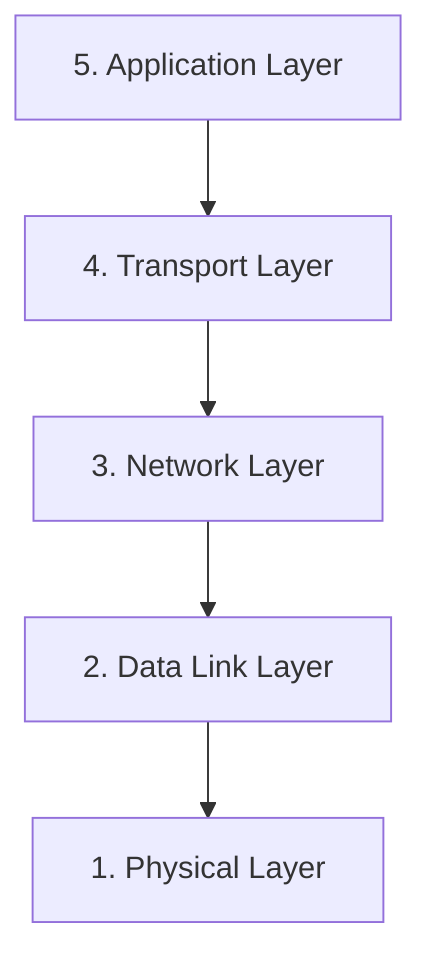

**How to read the diagram:** This learning version of TCP/IP names five layers. Read from top to bottom when sending and bottom to top when receiving. The link and physical layers handle each hop; the upper layers describe communication across the network.

### Application Layer

Provides protocols for communication between application processes.

**Remember it:** HTTP tells a browser how to ask for a page.

### Transport Layer

Provides end-to-end communication between application processes using port numbers.

**Remember it:** The port is like the department inside a building, such as the web service on port 443.

### Network Layer

Provides end-to-end communication between hosts across networks using IP addresses.

**Remember it:** The IP address identifies the building being reached across town.

### Data Link Layer

Provides delivery over each local link. Ethernet and Wi-Fi frames use link-layer addressing; switches forward Ethernet frames within a LAN.

**Remember it:** At each handoff, the parcel is relabeled for the next local courier.

### Physical Layer

Sends bits as electrical, optical, or radio signals over a physical medium.

**Remember it:** The courier's road, rail, or air route is the physical way a parcel crosses one leg.

## How TCP/IP Works

The TCP/IP layers work together while data travels from a client to a service. The diagram below distinguishes the **end-to-end conversation** from the **hop-by-hop frames and signals**.


**How to read the diagram:** Read the upper lines as the logical conversation between the client app and server app: application data goes to the right service, a transport port identifies its process, and IP identifies the destination host. Read the lower device path as the actual trip: client → switch → router → router → switch → server. Frames and physical signals carry the packet over each individual link; each router makes a new frame for its next link. The colored layer lines show responsibilities, not separate cables stretching end to end.

- **Application layer:** Provides services such as chat, video streaming, and email.
- **Transport layer:** Uses port numbers to identify application processes. HTTPS commonly uses TCP port 443; SMTP server-to-server transfer commonly uses TCP port 25.
- **Network layer:** Uses IP addresses and routers to move packets between networks.
- **Data link layer:** Uses switches and frames to move data across each local link.
- **Physical layer:** Carries the bits over the physical medium.

**Remember it:** A browser request keeps its end destination while each router replaces the local frame for the next link.

## Encapsulation

**Encapsulation** is the process of adding layer-specific control information to data as it moves down the network stack.

```text
Application: [Data]

Transport:   [L4 Header][Data]

Network:     [L3 Header][L4 Header][Data]

Data Link:   [L2 Header][L3 Header][L4 Header][Data][L2 Trailer]

Physical:    011101100011011110001111...
```

At the receiving side, the reverse process is called **decapsulation**. Each layer removes and processes its corresponding header or trailer until the original application data is recovered.

At a router, the incoming link frame is removed and a new frame is built for the outgoing link. The router normally forwards the IP packet without opening the application data.

```text
Physical:    Bits
                 ↓
Data Link:   Frame       → remove L2 header and trailer
                 ↓
Network:     Packet      → remove L3 header
                 ↓
Transport:   Segment     → remove L4 header
                 ↓
Application: Original Data
```

## Protocol Data Units

The message has a different name at each stage of the network stack. These names are called **Protocol Data Units (PDUs)**.

| Layer | PDU |
|---|---|
| Application | Data |
| Transport (Layer 4) | TCP segment or UDP datagram |
| Network (Layer 3) | Packet |
| Data Link (Layer 2) | Frame |
| Physical (Layer 1) | Bits |

The contents carried inside each PDU are called its **payload**:

- A transport segment's payload is application data (or data from an upper-layer protocol).
- A packet's payload is a segment.
- A frame's payload is a packet.

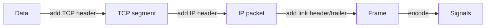

**How to read the diagram:** Each arrow adds information needed at the next layer: TCP makes a segment, IP wraps it as a packet, and the local link wraps that packet as a frame. The frame is encoded as signals for transmission.

**Remember it:** One message gets nested in envelopes; each envelope has a name at its own layer.

## Message Delivery Methods

When a device sends data, the network must determine who should receive it:

- One specific device
- Every device
- A specific group
- The nearest suitable device

The four main message-delivery methods handle these cases differently.

The examples below describe network delivery patterns. An app's “group chat” or “live stream” does not automatically use IP broadcast or multicast; many such apps send separate unicast connections.

### Unicast

**Unicast** is one-to-one communication: one sender sends data to one receiver.

Examples:

- A personal Netflix stream
- An API call
- An SSH session

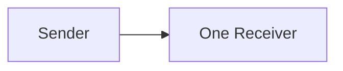

**How to read the diagram:** One arrow connects one sender to one chosen receiver. Other devices are not the intended recipients.

**Remember it:** One phone call to one person.

### Broadcast

**Broadcast** is one-to-all communication: one sender sends data to every device in the broadcast domain.

On an IPv4 LAN, an ARP request is a practical broadcast example. Routers normally do not forward such broadcasts to other networks.

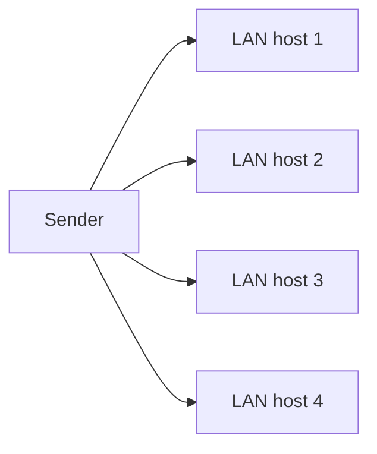

**How to read the diagram:** Every arrow starts at the same sender and reaches a host on the local broadcast network. The message goes to all of those hosts.

**Remember it:** A classroom announcement reaches everyone in that room, but not every room in the city.

### Multicast

**Multicast** is one-to-group communication: data is sent only to devices that have joined or subscribed to a particular group.

Example: an IP multicast stream on a network configured to support multicast. Ordinary internet video services commonly use separate unicast streams instead.

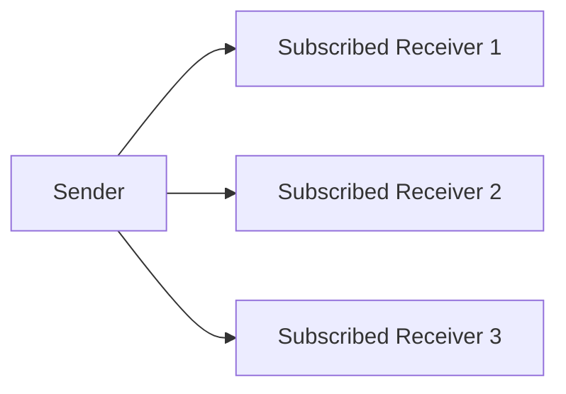

**How to read the diagram:** The sender addresses a group. Only receivers that joined that multicast group are shown receiving the message.

**Remember it:** A club announcement reaches only members who joined that group.

### Anycast

**Anycast** is one-to-one communication with a shared destination address announced from multiple locations. Routing chooses one reachable site based on network policy and path; it is not guaranteed to be the geographically nearest.

#### DNS Example

- When you enter a domain name, your device queries a DNS resolver. That query often goes to an anycast address.
- Cloudflare's public DNS resolver uses the IP address `1.1.1.1`.
- That single IP address is hosted by many servers around the world.
- A query from Mumbai might reach a site in or near Mumbai, while a London query might reach a different site. Peering and routing decisions can select a farther site.
- The IP address remains the same, but the physical machine handling the request can be different.

> Same service IP, different sites; the routing system selects a path.

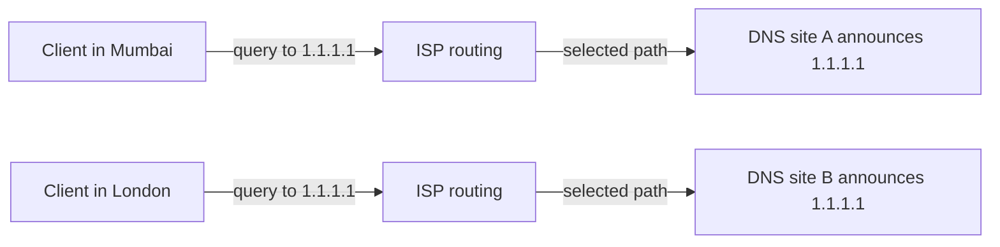

**How to read the diagram:** Both clients query the same IP address, `1.1.1.1`. Routing selects one site for each client's traffic; the chosen site depends on network routes and may not be the geographically closest one.

**Remember it:** Several shops share one advertised service number; the network directs you to one shop according to its routing rules.

## Sources and further reading

- [IETF RFC 1122: internet host communication layers](https://datatracker.ietf.org/doc/html/rfc1122)
- [IEEE 802.11 working group](https://www.ieee802.org/11/)
- [IANA service and port number registry](https://www.iana.org/assignments/service-names-port-numbers)
- [Cloudflare: why anycast may not reach the geographically closest site](https://developers.cloudflare.com/support/troubleshooting/general-troubleshooting/geographic-traffic-routing/)
