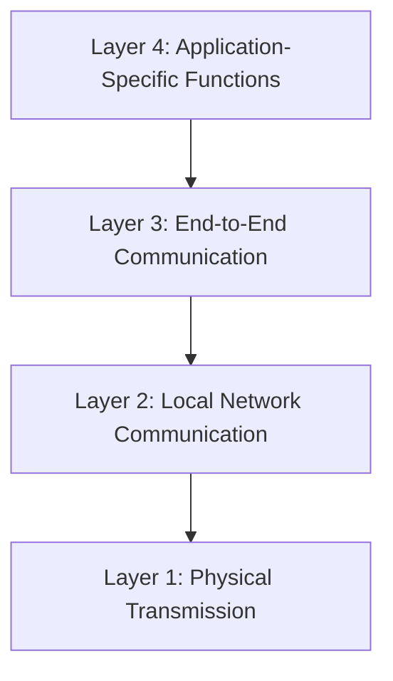
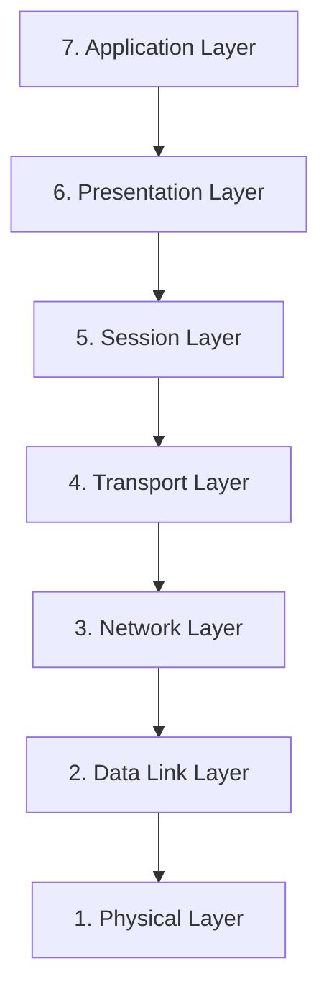
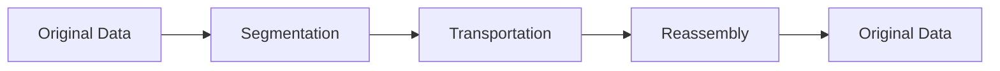
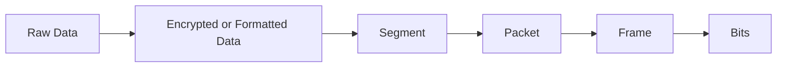
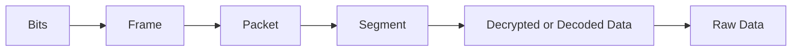
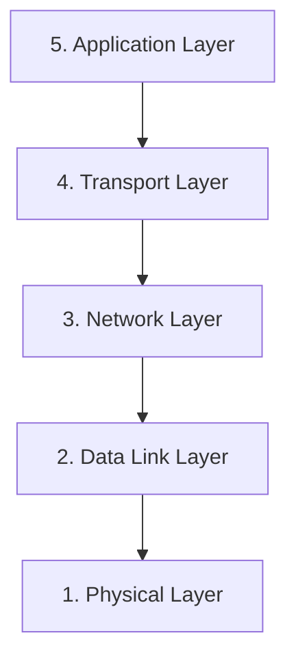
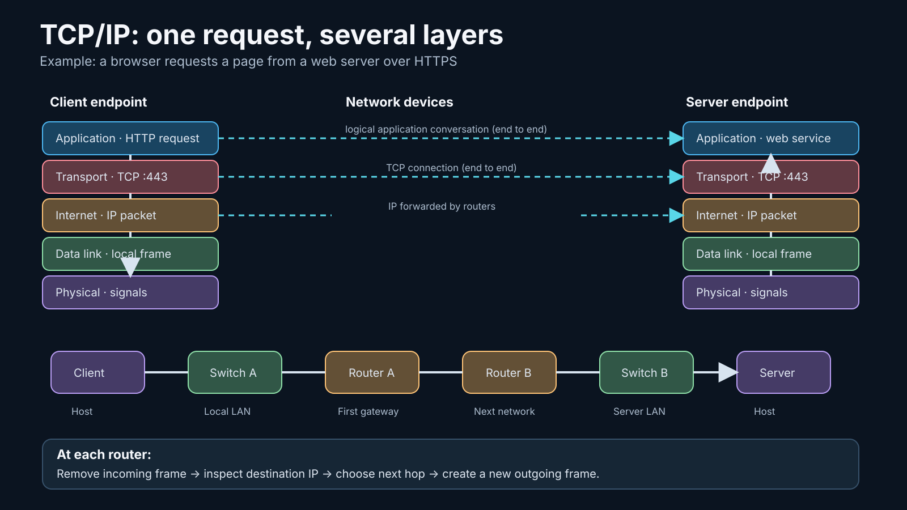
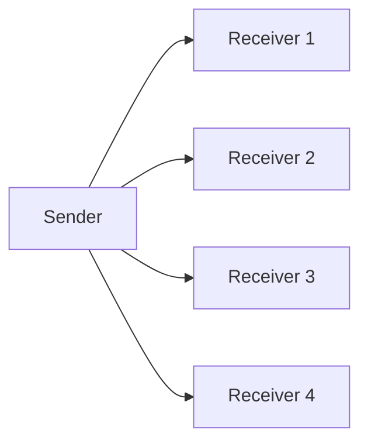
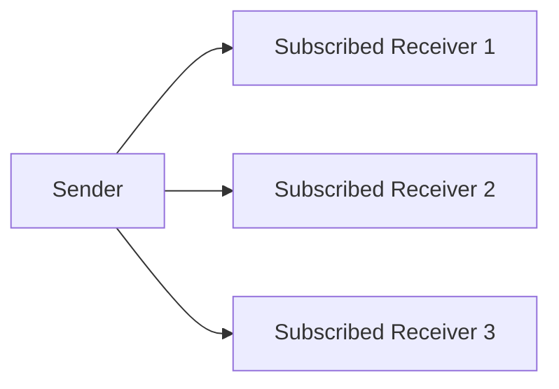
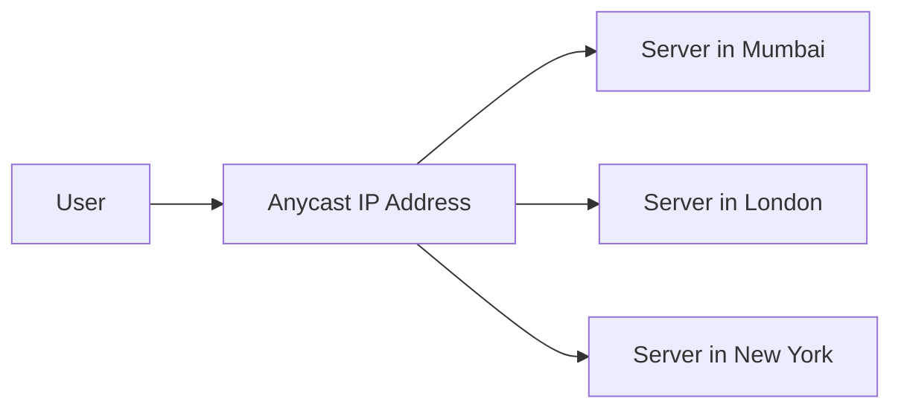

# Network Models

## Why Do We Need Network Models?

Suppose you are watching something on YouTube. You open the application on your phone, and the request:

1. Leaves your device.
2. Travels through Wi-Fi.
3. Crosses the internet.
4. Reaches a server in a data center.
5. Gets processed.
6. Returns with the requested data.

Your phone may be made by Apple, the server may be running Linux, the router in your house may come from a completely different manufacturer, and your ISP may use different equipment again.

They can understand each other because they follow common **network models and standards**.

### The Problem in the Early Days

In the early days, every company built its own system with:

- Its own cables
- Its own rules
- Its own method of sending data

None of these systems could communicate with each other.

The networking industry needed a common language—not only for cables and signals, but for every aspect of how data moves from one place to another.

That is why we have **layered network models**, where each layer has a different responsibility and uses a specific set of protocols.



## Who Defines Networking Standards?

Networking standards are developed by independent standards organizations.

### IEEE

The **IEEE (Institute of Electrical and Electronics Engineers)** develops many technologies used on local area networks, including:

- Ethernet
- Wi-Fi

### IETF

The **IETF (Internet Engineering Task Force)** is an open standards organization that defines many of the protocols used on the internet.

## OSI Model

The **OSI (Open Systems Interconnection) model** is a conceptual framework that helps standardize and describe the functions of communication systems and networks.

The model consists of seven layers:



### Innovation and Flexibility

The layered design provides the following benefits:

- Each layer can be improved separately.
- Innovations in physical media, such as faster cables, do not affect the other layers.
- It allows easier upgrades while maintaining compatibility.

## The Seven OSI Layers

### 7. Application Layer

The application layer is the human-computer interaction layer.

- Software through which users interact with network services works at this layer.
- A web browser is an example.

### 6. Presentation Layer

The presentation layer ensures that data is in a usable and correct format.

Its responsibilities include:

- Encryption and decryption
- Compression and decompression
- Translation between data formats
- Converting data into a machine-representable format

For example, translating between ASCII and EBCDIC is a form of data translation.

### 5. Session Layer

The session layer manages communication sessions between systems.

Its responsibilities include:

- Creating and maintaining sessions
- Managing the session of communication
- Authentication and authorization
- Using time frames or checkpoints during communication

### 4. Transport Layer

The transport layer makes sure that data is transferred efficiently from end to end.

Common protocols include:

- TCP
- UDP

Its main steps are:

1. Segmentation
2. Flow control
3. Error control



#### Segmentation

- Data received from the upper layer is divided into smaller units called **segments**.
- Each segment contains source and destination port numbers.
- Each segment contains a sequence number, which helps reassemble the segments in the correct order.

#### Flow Control

Flow control controls the amount of data being transferred so that the receiver is not overwhelmed.

#### Error Control

Error control checks the integrity of data and can add a checksum to each data segment.

### 3. Network Layer

The network layer is responsible for:

- Logical addressing through IP addresses
- Moving packets from a source to a destination, which is called **routing**
- Selecting the path that data will take
- Supporting some forms of load balancing

### 2. Data Link Layer

The primary functions of the data link layer include:

- Framing
- Physical addressing
- Error detection and correction
- Flow control

A frame includes:

- Source MAC address
- Destination MAC address

A **MAC address** is a 12-digit hexadecimal identifier assigned to a network interface.

### 1. Physical Layer

The physical layer represents the actual physical medium, such as Ethernet cables or wireless signals.

- A NIC (Network Interface Card) converts frames into bits through encoding.
- It transmits data as a stream of bits.
- Bits are carried using optical, electrical, or radio signals.

## Encapsulation and Decapsulation

As data moves from the client down the network stack, each layer prepares it for transmission:



On the server side, the process happens in reverse:



## TCP/IP Model

The **TCP/IP model (Transmission Control Protocol/Internet Protocol model)** is the set of communication protocols used on the internet. It provides end-to-end data communication.

In the five-layer version, it contains the following layers:



### Application Layer

Provides protocols for communication between application processes.

### Transport Layer

Provides end-to-end communication between application processes using port numbers.

### Network Layer

Provides end-to-end communication between hosts across networks using IP addresses.

### Data Link Layer

Provides hop-to-hop delivery within a local network using MAC addresses and switches.

### Physical Layer

Sends bits as electrical, optical, or radio signals over a physical medium.

## How TCP/IP Works

The TCP/IP layers work together while data travels from a user to a server.



- **Application layer:** Provides services such as chat, video streaming, and email.
- **Transport layer:** Uses port numbers to identify application processes. For example, SMTP commonly uses port 25.
- **Network layer:** Uses IP addresses and routers to move packets between networks.
- **Data link layer:** Uses switches and frames to move data across each local link.
- **Physical layer:** Carries the bits over the physical medium.

## Encapsulation

**Encapsulation** is the process of adding layer-specific control information to data as it moves down the network stack.

```text
Application: [Data]

Transport:   [L4 Header][Data]

Network:     [L3 Header][L4 Header][Data]

Data Link:   [L2 Header][L3 Header][L4 Header][Data][L2 Trailer]

Physical:    011101100011011110001111...
```

At the receiving side, the reverse process is called **decapsulation**. Each layer removes and processes its corresponding header or trailer until the original application data is recovered.

```text
Physical:    Bits
                 ↓
Data Link:   Frame       → remove L2 header and trailer
                 ↓
Network:     Packet      → remove L3 header
                 ↓
Transport:   Segment     → remove L4 header
                 ↓
Application: Original Data
```

## Protocol Data Units

The message has a different name at each stage of the network stack. These names are called **Protocol Data Units (PDUs)**.

| Layer | PDU |
|---|---|
| Application | Data |
| Transport (Layer 4) | Segment |
| Network (Layer 3) | Packet |
| Data Link (Layer 2) | Frame |
| Physical (Layer 1) | Bits |

The contents carried inside each PDU are called its **payload**:

- A segment's payload is application data.
- A packet's payload is a segment.
- A frame's payload is a packet.


## Message Delivery Methods

When a device sends data, the network must determine who should receive it:

- One specific device
- Every device
- A specific group
- The nearest suitable device

The four main message-delivery methods handle these cases differently.

### Unicast

**Unicast** is one-to-one communication: one sender sends data to one receiver.

Examples:

- A personal Netflix stream
- An API call
- An SSH session


### Broadcast

**Broadcast** is one-to-all communication: one sender sends data to every device in the broadcast domain.

A group announcement where every member receives the message is a useful analogy.



### Multicast

**Multicast** is one-to-group communication: data is sent only to devices that have joined or subscribed to a particular group.

Example: a live video stream delivered to subscribed viewers.



### Anycast

**Anycast** is one-to-nearest communication. Multiple servers in different locations share the same IP address, and network routing sends each request to the nearest or best available server.

#### DNS Example

- When you enter a domain name, your device queries a DNS resolver. That query often goes to an anycast address.
- Cloudflare's public DNS resolver uses the IP address `1.1.1.1`.
- That single IP address is hosted by many servers around the world.
- A query from Mumbai can reach a nearby server in Mumbai, while a query from London can reach a nearby server in London.
- The IP address remains the same, but the physical machine handling the request can be different.

> Same IP, different physical machines—the nearest suitable route wins.


