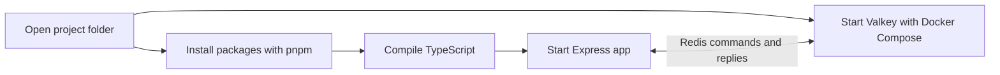

# Redis Backend Project — Setup and Troubleshooting

This is the practical companion to the [Redis concepts guide](./README.md). It
follows the project setup in the same order as the PowerShell command history,
then explains the errors encountered along the way. The final working route is:



**How to read the diagram:** Start in the project folder. One branch installs
packages, compiles TypeScript, and starts the Express app; the other starts
Valkey through Docker Compose. The two-way arrow means the app sends Redis
commands to Valkey and receives replies. Both services must be running for
Redis-backed features to work.

## 1. Open the project folder

The first entries were:

```powershell
backend-projects
backend-project
```

These are folder names, not PowerShell commands, so PowerShell cannot run them directly.
Use `cd` to change folders:

```powershell
cd C:\Users\vansh\backend-projects
code .
cd redis
```

- `cd <folder>`: moves into a folder.
- `code .`: opens the current folder (`.`) in VS Code.
- `cd redis`: moves into the Redis project folder.

**Remember it:** A folder path is a street address. `cd` is the instruction to
travel there; typing the address alone does not move the terminal.

## 2. Initialize the Node.js project

The first attempt was:

```powershell
pnpm init
```

It failed because PowerShell could not find pnpm. That means pnpm was not installed or was not available through PATH.

Install pnpm globally through npm:

```powershell
npm install -g pnpm
```

After installation, initialize the project:

```powershell
pnpm init
```

`pnpm init` creates `package.json`, which stores project information, dependencies, and scripts.

**Remember it:** `package.json` is the project's recipe card. `pnpm` reads it
to know which ingredients to install and which commands to run.

Useful check:

```powershell
pnpm --version
```

The current project requires pnpm 12.15.0. To install that exact version:

```powershell
npm install -g pnpm@12.15.0
```

## 3. Install TypeScript and Node.js types

```powershell
pnpm install typescript @types/node -D
```

- `typescript`: provides the TypeScript compiler (`tsc`).
- `@types/node`: provides TypeScript types for Node.js features such as `process.env`.
- `-D`: saves packages under `devDependencies` because they are used during development.

**Remember it:** TypeScript and type definitions are tools used to prepare the
meal; the running application does not serve the compiler to customers.

## 4. Install Express and its types

```powershell
pnpm install express@4.x
pnpm install @types/express@4.x -D
```

- `express@4.x`: installs Express version 4 as a runtime dependency.
- `@types/express@4.x`: gives TypeScript the Express type definitions.

Runtime packages go in `dependencies`. Development tools and type definitions go in `devDependencies`.

**Remember it:** Express is part of the working kitchen, while its type
definitions are instructions used while building that kitchen.

Shorter equivalent commands:

```powershell
pnpm add express@4
pnpm add -D typescript @types/node @types/express@4
```

## 5. Create the TypeScript configuration

The command history contains:

```powershell
tsc --init
```

This creates `tsconfig.json`, which controls TypeScript compilation.
If `tsc` is not recognized globally, use the project-local compiler:

```powershell
pnpm exec tsc --init
```

Important current settings:

```jsonc
"rootDir": "./src",
"outDir": "./dist"
```

- Write TypeScript source code in `src`.
- TypeScript generates JavaScript in `dist`.
- Do not edit generated `dist` files because the next build can overwrite them.

**Remember it:** `src` is your editable draft, `tsconfig.json` is the conversion
rulebook, and `dist` is the printed output regenerated from the draft.

## 6. Build and start the app

The scripts in `package.json` are:

```json
"scripts": {
  "build": "tsc -p .",
  "start": "node dist/index",
  "dev": "tsc-watch --onSuccess \"pnpm start\""
}
```

Run:

```powershell
pnpm build
pnpm start
```

- `pnpm build`: runs `tsc -p .`, reads this folder's `tsconfig.json`, and compiles `src` into `dist`.
- `pnpm start`: runs the compiled `dist/index.js` file with Node.js.
- Build before starting whenever the source has changed.

**Remember it:** `build` translates your TypeScript instructions into JavaScript;
`start` runs the translated instructions.

## 7. Add development watch mode

The next installation command was:

```powershell
pnpm install tsc-watch -D
```

`tsc-watch` watches TypeScript files. When a file changes, it recompiles the project.

The development script is:

```json
"dev": "tsc-watch --onSuccess \"pnpm start\""
```

Run it with:

```powershell
pnpm dev
```

It compiles TypeScript, starts the app after a successful compilation, and recompiles/restarts after saved changes. Stop it with `Ctrl+C`.

The escaped `\"` characters are quotation marks inside the JSON string.

**Remember it:** Watch mode is a kitchen timer that notices a changed recipe,
rebuilds the dish, and restarts the serving process.

## 8. EBADDEVENGINES error

The original dev script used:

```json
"dev": "tsc-watch --onSuccess \"npm start\""
```

TypeScript compiled successfully, but `npm start` failed because `package.json` declares pnpm as the required package manager.

The corrected script uses:

```json
"dev": "tsc-watch --onSuccess \"pnpm start\""
```

After changing it, stop the old watcher with `Ctrl+C` and run `pnpm dev` again.

**Remember it:** The project expects a pnpm ticket at the door. The watcher
used `npm start`, which presented a different ticket and triggered the package
manager check.

## 9. Environment variable and default port

Current code:

```ts
const port = process.env.PORT || 8000;
```

- Uses `PORT` when it exists and is not empty.
- Uses `8000` when `PORT` is `undefined` or an empty string.
- Environment variables are strings.

Explicit number conversion:

```ts
const port = Number(process.env.PORT || 8000);
```

A missing `.env` file does not always mean `PORT` is missing. The terminal or hosting platform can also set it. A `.env` file must be loaded before its values appear in `process.env`.

**Remember it:** `PORT` is a number written on a note passed in from the
environment. If no usable note arrives, the app opens door `8000`.

## 10. `||` versus `??`

- `||` uses the fallback for any falsy value: `false`, `0`, `""`, `NaN`, `null`, or `undefined`.
- `??` uses the fallback only for `null` or `undefined`.

```ts
0 || 10;        // 10
0 ?? 10;        // 0
"" || "hello";  // "hello"
"" ?? "hello";  // ""
```

For the port, `||` is reasonable because an empty port value should fall back to `8000`.

**Remember it:** `||` replaces any empty or false-like answer; `??` only
replaces an answer that was never supplied (`null` or `undefined`).

## 11. Current Express server

```ts
import express from "express";

const app = express();
const port = process.env.PORT || 8000;

app.get("/", (req, res) => {
  return res.json({ status: "success" });
});

app.listen(port, () => {
  console.log("server is running on port: ", port);
});
```

- `express()` creates the server application.
- `app.get("/", ...)` handles GET requests to `/`.
- `res.json(...)` returns JSON to the client.
- `app.listen(...)` starts the server on the selected port.
- With the default port, visit `http://localhost:8000/`.

The current source also has `/state`, `/books`, and `/books/total` routes; the
short example above focuses on the root route.

**Remember it:** `app.listen` opens the reception desk, a route such as `/`
names a service window, and `res.json` hands a response to the visitor.

## 12. Why package.json has no comments

`package.json` uses strict JSON, which does not support `//` or `/* ... */` comments. Comments would make it invalid for pnpm, npm, and Node.js tools.

Keep explanations in this notes file. `tsconfig.json` supports JSON with comments, so comments are allowed there.

**Remember it:** `package.json` is a strict form with fixed fields, while
`tsconfig.json` permits margin notes for humans.

## 13. `async` and `await` with Axios

`axios.get()` sends an HTTP request and immediately returns a `Promise`. The actual API result arrives later.

```ts
app.get("/books", async (req, res) => {
  try {
    const response = await axios.get(
      "https://api.freeapi.app/api/v1/public/books"
    );

    return res.json(response.data);
  } catch (error) {
    return res.status(500).json({ message: "Failed to fetch books" });
  }
});
```

- `async` allows the route function to use `await`.
- `await` waits for the Axios promise to finish and gives its resolved response.
- Without `await`, `response` would be a `Promise`, not the returned book data.
- `response.data` contains the API response body.
- The route must call `res.json()`, `res.send()`, or another response method; otherwise the client's request keeps waiting.
- Use `try/catch` because the external API request can fail.

**Remember it:** Axios asks another shop for the books. `await` waits for its
reply; `try/catch` handles a closed shop or a failed delivery.

## 14. ioredis: "not constructable" error

This default import causes a TypeScript error with the installed ioredis 6 and the project's NodeNext/ESM settings:

```ts
import Redis from "ioredis";
```

TypeScript interprets that import as the complete ioredis module object. A module object cannot be created with `new`, so it reports that the expression has no construct signatures.

Import the named `Redis` class instead:

```ts
import { Redis } from "ioredis";

const redis = new Redis({
  host: "localhost",
  port: 6379
});
```

`6379` is already a number, so `Number(6379)` is unnecessary.

**Remember it:** Import the actual `Redis` constructor rather than the entire
module package. You can instantiate a class; you cannot instantiate a box
containing all the module's exports.

## 15. Docker Compose: invalid Valkey image reference

An image reference follows `owner/image:tag`. This is invalid because it contains two tag separators:

```yaml
image: valkey:valkey:latest
```

Use the official Valkey image name:

```yaml
services:
  redis:
    image: valkey/valkey:latest
    ports:
      - "6379:6379"
```

Then start and verify it:

```powershell
docker compose up -d
docker compose ps
docker compose exec redis valkey-cli ping
```

A successful ping returns `PONG`.

**Remember it:** An image name has a repository path and one tag. `PING` and
`PONG` are a quick call-and-response check that the Valkey service is awake.

## Daily commands

While developing:

```powershell
cd C:\Users\vansh\backend-projects\redis
pnpm dev
```

Build and run manually:

```powershell
pnpm build
pnpm start
```

Install everything listed in an existing `package.json`:

```powershell
pnpm install
```

The app and the Valkey container are separate processes. Start both when you
want to exercise Redis-backed routes locally, and check the Compose service
with `docker compose ps` if the app cannot connect.

**Remember it:** One command prepares the kitchen (`pnpm install`), one runs
the restaurant (`pnpm dev`), and Compose opens the nearby storehouse (Valkey).

## References

- [Node.js environment variables](https://nodejs.org/api/process.html#processenv)
- [TypeScript configuration reference](https://www.typescriptlang.org/tsconfig/)
- [Docker Compose services](https://docs.docker.com/compose/compose-file/05-services/)
- [Valkey installation](https://valkey.io/topics/installation/)
