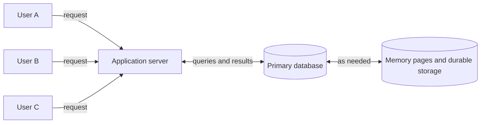
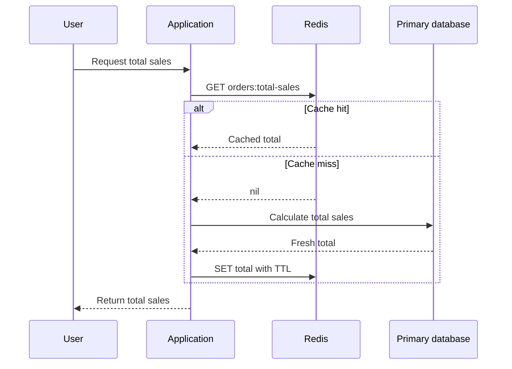
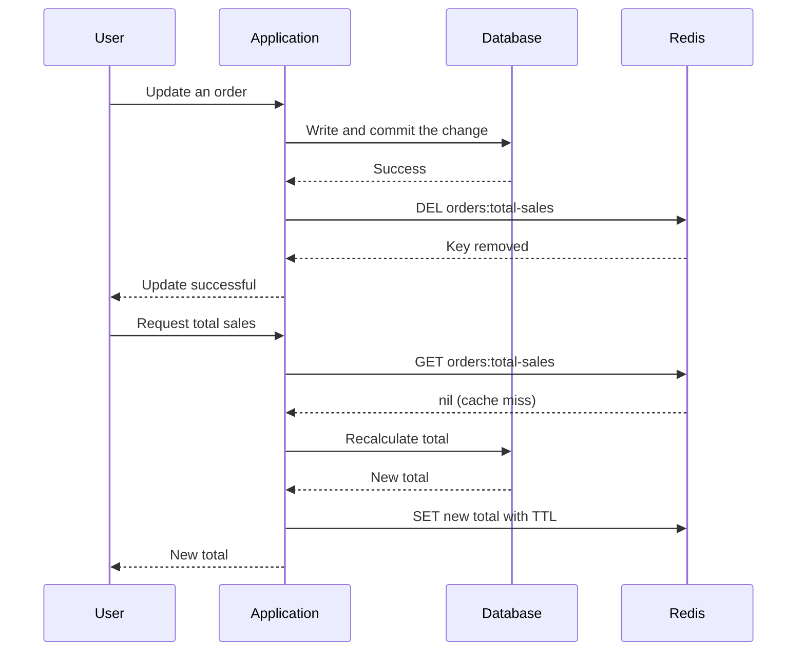
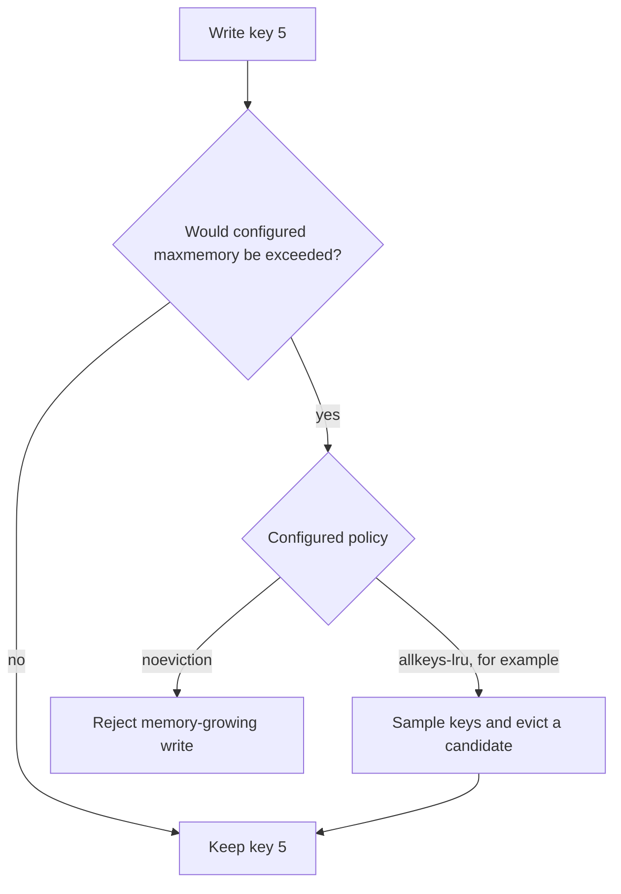
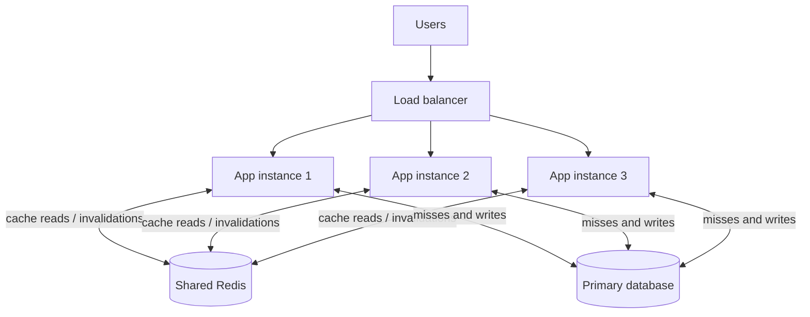
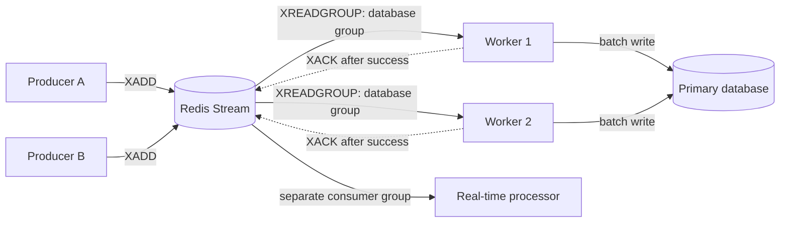
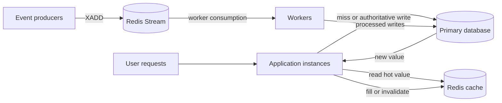

# Redis Notes

Redis is an **in-memory data structure store** commonly used as a cache, database,
message broker, and streaming engine. Imagine a busy shop: the main database is
its complete stockroom record, while Redis can keep frequently requested answers
at the counter. These notes follow that idea from one slow query to a shared
cache and, finally, a stream of incoming events.

## Additional Documentation

- [Project setup, commands, and troubleshooting](./PROJECT-SETUP.md)
- [WebSockets and Socket.IO notes](./WEBSOCKETS.md)

## Table of Contents

1. [The problem Redis solves](#1-the-problem-redis-solves)
2. [Why RAM helps](#2-why-ram-helps)
3. [Caching an expensive result](#3-caching-an-expensive-result)
4. [The cache invalidation problem](#4-the-cache-invalidation-problem)
5. [Limited memory and eviction](#5-limited-memory-and-eviction)
6. [What Redis is](#6-what-redis-is)
7. [Redis in a distributed system](#7-redis-in-a-distributed-system)
8. [Real-world risks and solutions](#8-real-world-risks-and-solutions)
9. [Valkey](#9-valkey)
10. [Redis Streams for high-throughput data](#10-redis-streams-for-high-throughput-data)
11. [Quick summary](#11-quick-summary)

---

## 1. The problem Redis solves

In a traditional application, every user request reaches the application server,
and the server reads from or writes to a database.



The primary database provides the authoritative data layer. Depending on the
database and configuration, it may read cached pages from memory or durable
storage. Query parsing, joins, locks, computation, and network transfer can
still add substantial work. A database lookup is **not always a disk read**.

Modern users expect pages and APIs to respond quickly. A fast internet connection
cannot fix a slow database query, so repeated database work can still produce a
slow application and a poor user experience.

> **Core problem:** data stored on durable secondary storage is essential, but
> repeatedly computing or fetching the same result can be too slow.

Redis does not replace the primary database in this scenario. It adds a fast
in-memory layer for data that benefits from quick access.

**Remember it:** A shopkeeper can repeatedly search the stockroom ledger for a
popular item, or keep the latest answer at the counter. The ledger remains the
source of truth.

---

## 2. Why RAM helps

### Primary memory (RAM)

**Advantages**

- Very fast compared with SSD or HDD storage.
- Well suited to frequently accessed and temporary data.
- Lets an application serve a previously computed result without rerunning the
  original database query.

**Limitations**

- RAM is volatile: data can be lost when the process or machine stops unless a
  persistence mechanism is configured.
- RAM has a smaller capacity and a higher cost per gigabyte than disk storage.
- Its size is limited, so the application cannot keep everything in memory.

| Property | RAM | SSD/HDD |
| --- | --- | --- |
| Access speed | Very fast | Slower |
| Capacity | Usually smaller | Usually much larger |
| Data after power loss | Volatile by default | Persistent |
| Typical role here | Cache / hot data | Primary durable data |

Exact latency depends on the hardware, network, data size, and command. The
important point is that an in-memory lookup is normally much faster than repeating
a complex database operation.

**Remember it:** RAM is a small desk beside you; disk storage is a much larger
filing room. The desk is faster to reach but cannot hold every folder, and its
contents need protection if the machine stops.

---

## 3. Caching an expensive result

Suppose an `orders` table contains 100 million rows. Calculating a large aggregate
such as total sales may be expensive:

```sql
SELECT SUM(amount) FROM orders;
```

If the result is requested repeatedly, the application can calculate it once and
store it in Redis under a key such as `orders:total-sales`.

### Cache-aside read pattern



The application follows this sequence:

1. Ask Redis for the cached value.
2. If it exists, return it immediately. This is a **cache hit**.
3. If it does not exist, query the database. This is a **cache miss**.
4. Save the result in Redis with an expiration time (TTL).
5. Return the result to the user.

Example pseudocode:

```ts
async function getTotalSales() {
  const cacheKey = "orders:total-sales";
  const cachedValue = await redis.get(cacheKey);

  if (cachedValue !== null) {
    return Number(cachedValue);
  }

  const total = await db.calculateTotalSales();
  await redis.set(cacheKey, String(total), "EX", 60);
  return total;
}
```

The database remains the source of truth; Redis holds a temporary copy of the
computed result.

**Remember it:** The first customer makes the shopkeeper calculate today's
total. The result goes on a sticky note; later customers can read the note
until it expires. This is a cache hit after the first cache miss.

---

## 4. The cache invalidation problem

Assume Redis currently contains a total of `500M`. A new order is written to the
database and the real total becomes `600M`. If the cached value is not updated or
deleted, users continue receiving the stale `500M` result.

This is the **cache invalidation problem**: the primary data changes while its
cached copy remains old.

### Invalidate the cache after a successful write



Example pseudocode:

```ts
async function updateOrder(orderId: string, input: UpdateOrderInput) {
  await db.updateOrder(orderId, input);
  await redis.del("orders:total-sales");
}
```

Important real-world rules:

- Invalidate the key only after the database transaction succeeds.
- Give cached values a TTL so stale entries eventually expire even if an
  invalidation is missed.
- Delete or refresh only the affected keys instead of clearing the entire cache.
- Concurrent reads and writes can still create race conditions, so critical data
  may require versioned keys, locks, or a more carefully designed write strategy.

Clearing every cached value after each write is simple, but it removes useful hot
data and causes many requests to hit the database again.

**Remember it:** If the stockroom ledger changes from `500M` to `600M`, erase
the old total on the counter's sticky note. The next reader gets a freshly
calculated note. Erasing *all* notes after one order wastes useful work.

---

## 5. Limited memory and eviction

RAM is finite. Suppose a cache can hold four items:

```text
Current cache: [1] [2] [3] [4]
New item:      [5]
```

When item `5` arrives, Redis may need to remove an older key **if a memory limit
and an eviction policy are configured**. An LRU-style policy selects a key that
has not been used recently; other policies make different choices.



Redis memory behavior is controlled using `maxmemory` and
`maxmemory-policy`. Available policies include:

- `allkeys-lru`: evict least-recently-used keys from all keys.
- `allkeys-lfu`: evict least-frequently-used keys.
- `volatile-lru`: apply LRU only to keys that have a TTL.
- `volatile-ttl`: evict expiring keys with the shortest remaining TTL.
- `noeviction`: reject new writes when the memory limit is reached.

Redis uses an approximation of LRU rather than maintaining a perfect global LRU
list. The correct policy depends on whether Redis is being used purely as a cache
or also holds data that must not be evicted.

**Remember it:** A four-slot shelf is full. If the policy is LRU, remove an
item that has sat untouched for the longest time to make room for item `5`.
With `noeviction`, the shelf refuses the new item instead.

---

## 6. What Redis is

Redis can be understood as a standardized server and data-structure layer that
manages data primarily in memory.

> **Redis is an in-memory data structure store that can be used as a cache,
> database, message broker, and streaming engine.**

Redis stores data using keys and supports more than basic string values, including
hashes, lists, sets, sorted sets, streams, and other data structures.

```text
user:42:name       -> "Vansh"
product:10:stock   -> "37"
orders:total-sales -> "600000000"
```

### A useful analogy

- A relational database provides an organized interface over durable secondary
  storage.
- Redis provides a network-accessible data-structure interface over memory, with
  optional disk persistence.

Redis runs as its own server process. Application servers connect to it over the
network, usually on port `6379`, and issue commands such as `GET`, `SET`, `DEL`,
`HGET`, and `XADD`.

**Remember it:** PostgreSQL and Redis are both services you ask questions of.
PostgreSQL usually keeps the authoritative business records; Redis often keeps
quickly accessible copies or short-lived state. Their roles depend on the app.

### Redis is not always non-persistent

Redis is memory-first, but saying that it is never persistent is incorrect. Redis
supports:

- **RDB snapshots**: periodic point-in-time snapshots.
- **AOF (Append Only File)**: a log of write operations.
- **RDB + AOF**: both mechanisms together.
- **No persistence**: common when Redis is used only as a disposable cache.

Durability must be configured according to the use case. Even with persistence,
Redis should not automatically be treated as a replacement for the application's
primary database.

**Remember it:** Keeping a copy of the desk notes in a notebook is like
enabling snapshots or a write log. It helps recovery, but the amount of recent
work at risk depends on how and when the notebook is updated.

---

## 7. Redis in a distributed system

When an application is scaled horizontally, many application servers can share
one logical Redis cache. A request can reach any application instance and still
use the same cached data.



This is a **distributed cache** because separate application processes use a
shared cache service.

Benefits include:

- All application instances see the same cached value.
- Expensive results do not need to be recomputed by every server.
- Application servers remain easier to scale because cached state is outside the
  individual process.
- Redis commands are atomic, so many clients can safely operate on keys; however,
  multi-step application workflows can still have race conditions.

**Remember it:** Three cashiers share one counter note rather than each keeping
a private note. Any cashier can serve the next customer, and each cashier can
consult the stockroom ledger on a miss.

---

## 8. Real-world risks and solutions

Adding Redis improves speed, but it introduces another system that must be
designed and operated correctly.

| Risk | What can happen | Common protection |
| --- | --- | --- |
| Stale cache | Redis returns old data after a DB update | Invalidation, TTLs, versioned keys |
| Memory fills | New writes fail or useful keys are removed | `maxmemory`, an appropriate eviction policy, monitoring |
| Cache flush | Many requests suddenly hit the DB | Avoid broad clears, add jittered TTLs, warm important keys |
| Redis server failure | Cache becomes unavailable | Timeouts, DB fallback, replicas, Sentinel/managed HA |
| Cache stampede | Many clients rebuild the same missing key | Lock/single-flight, stale-while-revalidate, TTL jitter |
| Durable-data loss | Memory-only data disappears after failure | RDB/AOF, replication, or keep the DB as source of truth |

An application should treat a cache failure as a performance problem rather than
an immediate correctness failure whenever possible. If Redis is unavailable, the
application can temporarily read from the primary database, subject to rate and
capacity limits.

**Remember it:** If the counter notes disappear, the shop can still consult
the stockroom ledger, but a sudden crowd might overwhelm the stockroom staff.

---

## 9. Valkey

Valkey is a vendor-neutral, BSD-licensed, open-source in-memory data store and a
continuation of Redis OSS. It is compatible with Redis OSS 7.2 and earlier
open-source versions, which makes migration straightforward for compatible
workloads and clients.

This project already uses the official Valkey container image:

```yaml
services:
  redis:
    image: valkey/valkey:latest
    ports:
      - "6379:6379"
```

This local Compose example has no persistent volume. If the container is
recreated, do not assume its data survives. That is acceptable for a
rebuildable cache; durable data needs a deliberately configured storage and
recovery plan.

For repeatable production builds, pin a tested version instead of relying on
`latest`:

```yaml
image: valkey/valkey:<tested-version>
```

Start it with:

```bash
docker compose up -d
```

Existing Redis-compatible clients such as `ioredis` can connect to Valkey through
the same Redis protocol. Compatibility should still be tested before migrating a
production workload, especially when moving between newer major versions.

**Remember it:** Valkey is another implementation that speaks the familiar
Redis protocol, much as two brands of router can follow the same networking
standard. Test the features your application actually uses before switching.

---

## 10. Redis Streams for high-throughput data

A database can become overloaded when producers write bursts of events directly
to it. Redis Streams provides an append-only, ordered log that can sit between
producers and downstream workers.



Real-world flow:

1. Producers append events with `XADD`.
2. Redis stores every event with an ordered stream ID.
3. Workers in a consumer group use `XREADGROUP` to share the work.
4. Workers process events and write them to the database, often in batches.
5. A worker sends `XACK` to Redis only after processing succeeds. Acknowledging
   removes the entry from that group's pending list; it does not by itself
   delete the entry from the stream.
6. Pending, failed, and retried messages must be monitored.

Streams can absorb bursts and allow consumers to process data at a controlled
rate. They do not make database capacity unlimited: if producers remain faster
than consumers, the stream backlog keeps growing. Production systems therefore
need retention/trimming, memory limits, monitoring, retry handling, and idempotent
consumers.

Redis Streams is useful for event processing, telemetry, activity feeds,
background jobs, and moving data into durable storage. For large, long-retention,
multi-partition event platforms, a dedicated streaming system may be more
appropriate.

**Remember it:** Producers put order slips on a numbered conveyor belt.
Workers take slips at a sustainable pace, write completed orders to the ledger,
and mark their own work done. If slips arrive faster than workers finish, the
belt fills up; the buffer does not create unlimited capacity.

---

## 11. Quick summary



- The primary database remains the source of truth in the cache-aside pattern.
- Redis keeps frequently used or computed data in memory for fast access.
- Cache hits reduce database load; cache misses rebuild the cached value.
- Writes require a cache invalidation strategy to avoid stale results.
- TTLs and eviction policies control the lifetime of keys and memory usage.
- Multiple application servers can share Redis as a distributed cache.
- Redis can use RDB and/or AOF persistence; it is not inherently non-persistent.
- Valkey is an open-source Redis-compatible alternative.
- Redis Streams can buffer and distribute high-throughput event processing.

**Remember the whole picture:** Database = authoritative ledger; Redis cache =
fast counter note; TTL/eviction = when notes disappear; invalidation = erasing
an outdated note; Streams = numbered conveyor belt for incoming work.

## Official references

- [Redis introduction](https://redis.io/about/)
- [Redis cache-aside](https://redis.io/docs/latest/develop/use-cases/cache-aside/)
- [Redis key eviction](https://redis.io/docs/latest/reference/eviction/)
- [Redis persistence](https://redis.io/docs/latest/operate/oss_and_stack/management/persistence/)
- [Redis Streams](https://redis.io/docs/latest/develop/data-types/streams/)
- [Valkey introduction](https://valkey.io/topics/introduction/)
- [Migrating from Redis to Valkey](https://valkey.io/topics/migration/)
