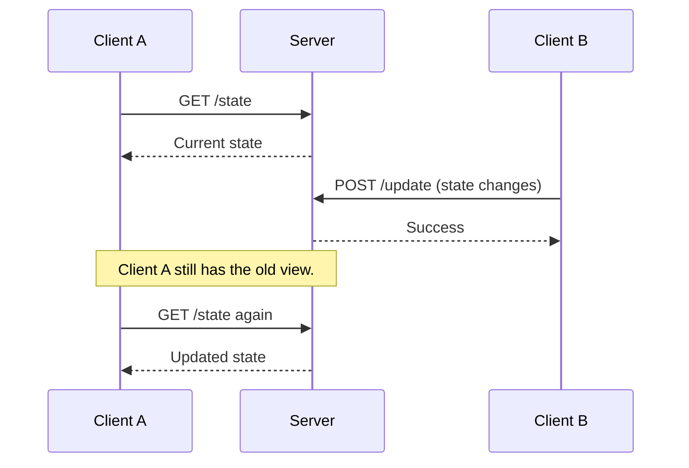
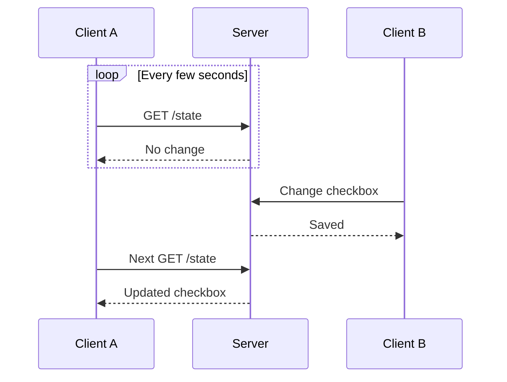
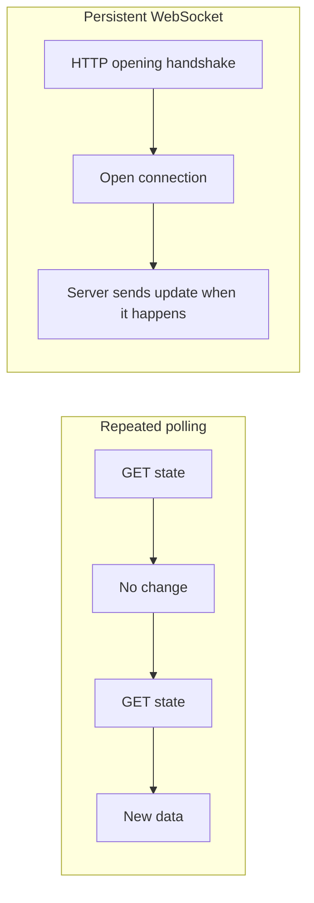
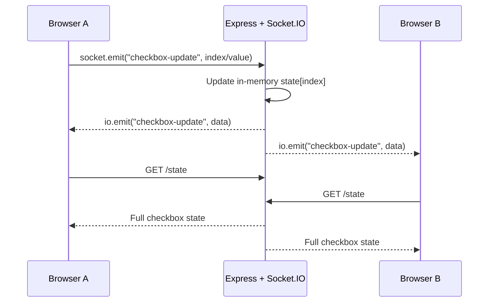
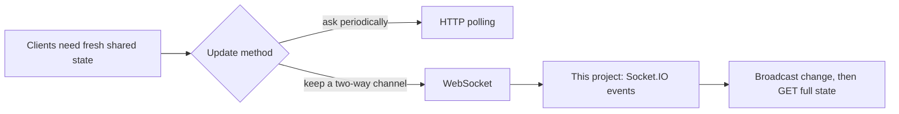

# WebSockets and Socket.IO: From Requests to Live Updates

These notes follow the three handwritten pages on sockets. They explain why a
request–response API feels awkward for live updates, how a WebSocket connection
works, and how the Socket.IO code in this folder applies the idea.

## Contents

1. [Start with HTTP](#1-start-with-http)
2. [Why polling becomes awkward](#2-why-polling-becomes-awkward)
3. [What a WebSocket changes](#3-what-a-websocket-changes)
4. [Connection setup and overhead](#4-connection-setup-and-overhead)
5. [WebSocket versus Socket.IO](#5-websocket-versus-socketio)
6. [How this project's checkbox demo works](#6-how-this-projects-checkbox-demo-works)
7. [What the current demo does and does not persist](#7-what-the-current-demo-does-and-does-not-persist)
8. [Quick recap](#8-quick-recap)

## 1. Start with HTTP

In the familiar HTTP pattern, the client sends a request and the server sends a
response. If the client needs fresh information later, it can send another
request. A second browser tab does not automatically learn about a change
made by the first tab.



The handwritten note draws a connection opening and closing around each
request. That is a useful picture of *separate request–response exchanges*,
but a new TCP connection is **not** required for every HTTP request. HTTP/1.1
normally reuses persistent connections. The key limitation here is that a
standard HTTP response answers a request; the server cannot use that completed
response to send arbitrary later updates to Client A.

**Remember it:** Asking a receptionist “Has my parcel arrived?” gets one
answer. If the parcel arrives five minutes later, that answer does not change.
You must ask again or arrange for the receptionist to notify you.

## 2. Why polling becomes awkward

For a chat app or a shared checkbox board, clients want to see changes made by
other clients. One approach is **polling**: ask the server repeatedly whether
anything changed.



Polling has two tradeoffs:

- **Delay:** a change may not appear until the next poll.
- **Repeated work:** many clients send requests even when nothing changed.

Polling can still be a sensible choice for infrequent updates. **Long polling**
keeps a request waiting until new data or a timeout, reducing empty responses.
Server-Sent Events can also push updates in one direction. Real-time features
are therefore possible over HTTP; the notes' “not possible” means the basic
one-request/one-response pattern alone is a poor fit for two-way live updates.

**Remember it:** Checking the mailbox every ten seconds works, but most trips
are wasted and a new letter waits until your next check.

## 3. What a WebSocket changes

The WebSocket protocol starts with an HTTP opening handshake. In the common
HTTP/1.1 case, the client requests an **Upgrade** and the server accepts with
`101 Switching Protocols`. After that, the same underlying connection carries
WebSocket frames until it closes. Both sides can send messages independently:
this is **full-duplex** communication.

```mermaid
sequenceDiagram
    participant C as Client
    participant S as Server
    C->>S: HTTP GET + Upgrade: websocket
    S-->>C: 101 Switching Protocols
    Note over C,S: Connection stays open; WebSocket frames follow.
    C->>S: Checkbox changed
    S-->>C: A later update or acknowledgement
    S->>C: Another user's change (no new GET required)
    C->>S: New message
```

WebSocket normally runs over TCP; `wss://` adds TLS. A live connection does
not mean zero latency or unlimited capacity: messages still travel through the
network, and each open client consumes server and network resources. If the
connection drops, the application must reconnect and decide how to recover
missed state.

**Remember it:** Instead of repeatedly sending letters to ask for news, the
client and server open a phone call. Either side can speak while the call is
active.

## 4. Connection setup and overhead

The third handwritten page describes repeated connection setup and teardown
as **overhead**. Setup takes time and bytes, and polling adds HTTP requests,
headers, and server work for each check. WebSocket pays an opening handshake
once, then sends smaller framed messages over the ongoing connection.



The comparison is about workload, not a guarantee that WebSocket is always
faster. For rare updates, an ordinary HTTP request may be simpler and cheaper.
For frequent two-way messages, avoiding repeated polls often makes the live
connection a better fit.

**Remember it:** Leaving a phone call open avoids dialing for every sentence,
but keeping thousands of calls open also costs resources.

## 5. WebSocket versus Socket.IO

The code in this folder uses **Socket.IO**. Socket.IO is an event-based library,
not a plain WebSocket server. It can use WebSocket underneath, but it adds its
own protocol and features, such as named events, reconnection, broadcasting,
and an HTTP long-polling fallback. By default, a Socket.IO client may begin
with polling and then upgrade its transport to WebSocket when possible.

| Term | Meaning in these notes |
| --- | --- |
| HTTP | Request and response protocol used by the Express routes |
| WebSocket | Standard full-duplex protocol after an opening handshake |
| Socket.IO | Library used here for live named events; can run over WebSocket or another supported transport |
| TCP | Transport beneath HTTP/1.1 and the usual WebSocket connection |

A browser's native `new WebSocket(...)` client cannot directly speak to this
Socket.IO server. The page loads Socket.IO's client script and calls `io()`.
Likewise, `io.emit(...)` is a Socket.IO operation, not a raw WebSocket API.

**Remember it:** WebSocket is the phone line. Socket.IO is a calling service
that can use that line while adding event names, reconnection behavior, and
fallback routes.

## 6. How this project's checkbox demo works

The server wraps the Express app in a Node HTTP server, attaches Socket.IO to
it, and listens through that HTTP server:

```ts
const httpServer = http.createServer(app);
const io = new Server();
io.attach(httpServer);

io.on("connection", (socket) => {
  socket.on("checkbox-update", (data) => {
    state[data.index] = data.value;
    io.emit("checkbox-update", data);
  });
});

httpServer.listen(port);
```

The page at `public/index.html` loads `/socket.io/socket.io.js` and calls
`io()`. On a checkbox change, it sends an event. The server changes the
in-memory `state` array and broadcasts the event to **all connected clients**,
including the sender. On receiving it, each page calls `GET /state` and
refreshes all checkbox values.



There is also a server-side `message` handler that broadcasts
`server-message`. The browser listens for `server-message` and appends it
to a list, but the current page has no input that emits a `message` event.
The checkbox demonstration is the active interaction shown in the UI.

**Remember it:** One person flips a shared switch; the server announces that
a switch changed; every viewer then asks for the latest full switchboard.

## 7. What the current demo does and does not persist

The checkbox array lives in the Node process's memory. Restarting that
process resets the array. The Redis/Valkey connection elsewhere in
`src/index.ts` is used for rate limiting and a book-page-count cache; the
checkbox state and Socket.IO broadcasts **do not use Redis** in this demo.

The current broadcast reaches clients connected to this one Socket.IO server.
If the app later runs on multiple server instances, a cross-server adapter
would be needed for broadcasts to reach clients on the other instances, and
the checkbox state would need an appropriate shared store. Socket.IO's Redis
adapter uses Redis Pub/Sub for cross-server event delivery; merely having
`ioredis` in this project does not configure that adapter.

The sample also trusts the incoming `index` and `value`. A production shared
board would validate event data and decide who may change the state. These
are limits of the demo, not extra behavior hidden inside WebSocket.

**Remember it:** This switchboard is written on one server's whiteboard. A
restart wipes it, and a second office would have a different whiteboard until
both offices share state and announcements.

## 8. Quick recap



- HTTP requests are useful for snapshots such as `GET /state`.
- Polling repeatedly asks for changes, adding delay and repeated work.
- A WebSocket connection allows both endpoints to send messages while open.
- Socket.IO is the library in this project and may use WebSocket as a transport.
- The current demo broadcasts checkbox changes but stores state only in one
  Node process; its Redis/Valkey client serves unrelated routes.

## Sources

- [RFC 6455: The WebSocket Protocol](https://www.rfc-editor.org/rfc/rfc6455)
- [RFC 9112: HTTP/1.1 persistent connections](https://www.rfc-editor.org/rfc/rfc9112)
- [Socket.IO introduction and transport behavior](https://socket.io/docs/v4/)
- [Socket.IO server API: attaching to an HTTP server](https://socket.io/docs/v4/server-api/)
- [Socket.IO broadcasting API](https://socket.io/docs/v4/tutorial/api-overview)
- [Socket.IO Redis adapter](https://socket.io/docs/v4/redis-adapter)
