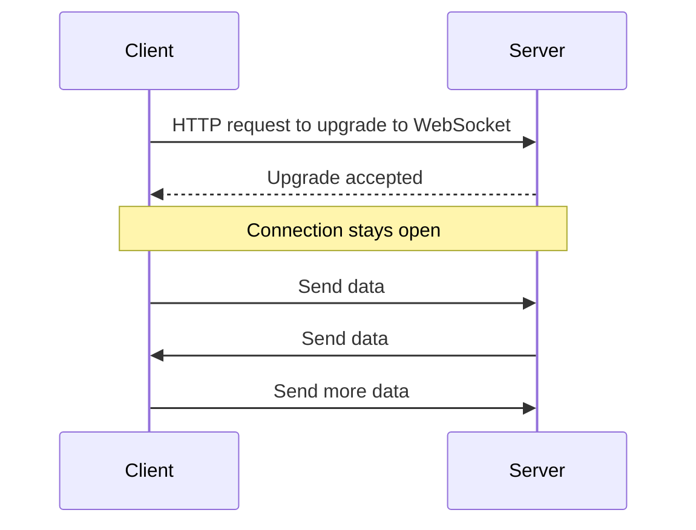
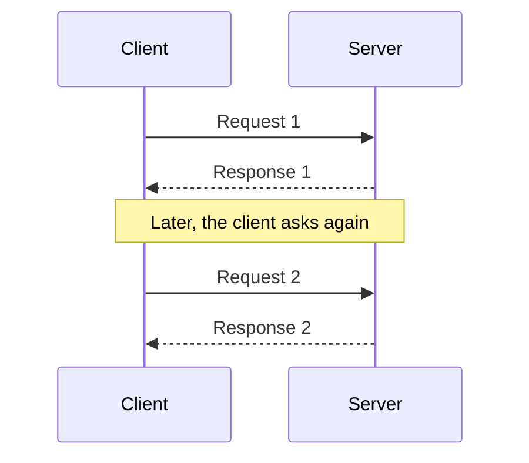
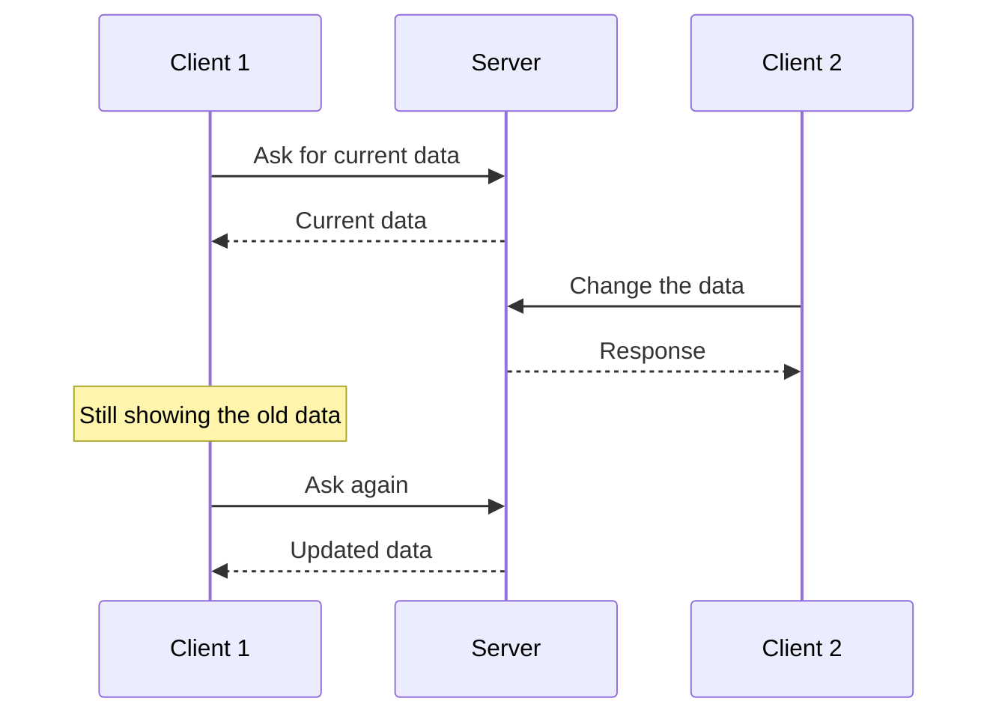
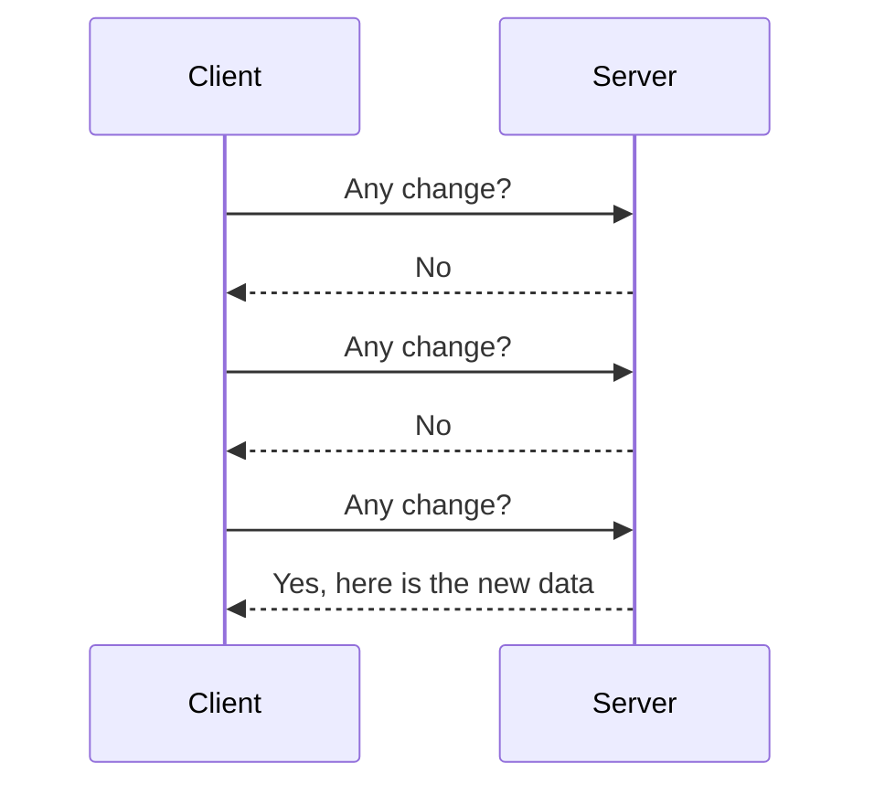
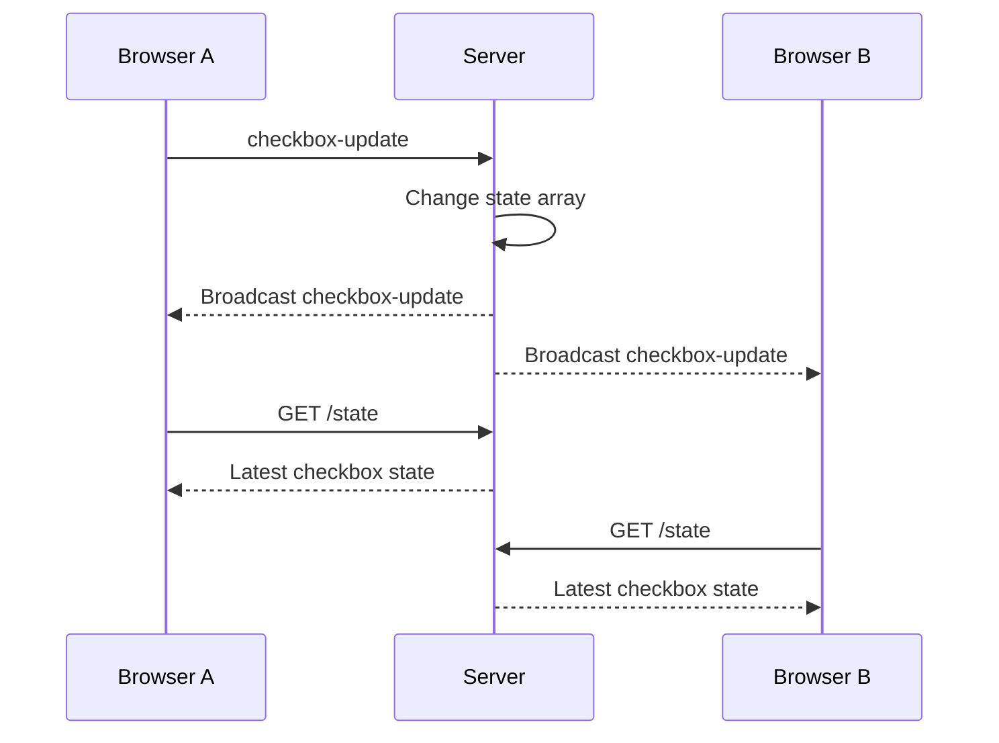

# Sockets and WebSockets

These notes follow my handwritten pages in the same order: what a WebSocket
connection is, why the usual request–response pattern is difficult for a
real-time app, what polling does, and why keeping a connection open helps.

## 1. What is a WebSocket?

An HTTP request can ask the server to **upgrade** the connection to the
WebSocket protocol. Once the WebSocket connection is established, it stays
open until one side closes it or the connection is lost.

WebSocket is **full-duplex**: both the client and the server can send data to
each other over the open connection. They do not have to wait for a new HTTP
request before sending every message. WebSocket normally runs over TCP.



**How to read the diagram:** Time moves downward. The first two arrows create
the connection; the arrows after “Connection stays open” are messages on
that same connection. Either side can start sending.

**Real-world example:** Think of a phone call. After the call connects, either
person can speak without starting a new call for every sentence.

> **Small clarification:** The standard WebSocket handshake uses an HTTP/1.1
> Upgrade request. This project uses Socket.IO, which can begin with HTTP
> polling and then upgrade its transport to WebSocket when available.

## 2. Why do we need it?

First, consider a normal HTTP request–response cycle. The client asks for
something; the server responds. If the client wants to know something new
later, it makes another request.



**How to read the diagram:** Each right-pointing arrow is a client request;
the matching left-pointing arrow is that request's response. The client
initiates the second exchange when it wants fresh information.

That pattern works well when the client knows when it needs data. In a chat
app, though, another person can send a message at any moment. The first
client will not know about the new message until it asks again or receives
some other notification.

Suppose **Client 1** fetched the current data and **Client 2** then changed
something on the server. Client 1 still has the old data until its next
request.



**How to read the diagram:** Client 2 changes the data after Client 1's
first request. No arrow goes to Client 1 at that moment, so its view stays
old until it asks again.

**Real-world example:** You ask a shop whether an item is in stock. If the
stock changes after the shop answers, you do not know until you call again.

> **Small clarification:** An HTTP response finishes, but HTTP/1.1 can reuse
> the underlying TCP connection for later requests. “One request, one
> response” does not always mean “open and close a TCP connection each time.”

## 3. Polling

One way to keep Client 1 updated is to make it ask the server repeatedly:
“Has anything changed?” This is called **polling**.



**How to read the diagram:** The client sends the same question three times.
The first two exchanges deliver no new information; only the third finds
the change.

The handwritten notes point out two problems:

- There can be a delay between the change and the next poll.
- Many requests may be sent even when nothing has changed, adding network
  traffic and work for the server.

**Real-world example:** Checking your mailbox every minute eventually finds
a letter, but most checks are empty. A letter can also sit there until your
next check.

Polling is still useful in some applications. The point here is that it can
be inefficient when many clients need frequent updates.

## 4. The overhead of repeated requests

Sending another request involves request headers and processing. If a new
connection must be established, that setup adds more overhead. With many
clients polling often, the repeated work can grow.

The idea in my diagram is:

```text
Ask → receive data → ask again → receive data → ...
       repeated request/response work
```

A WebSocket connection is established once and then reused for messages in
both directions:

```text
Open connection → exchange data ↔ exchange more data → close connection
```

**Real-world example:** Calling a friend separately for every sentence takes
more effort than having one conversation. The open call is useful when there
is a lot to say, although keeping it open also uses resources.

> **Small clarification:** WebSockets do not make ordinary HTTP “bad.”
> They are useful when the application needs frequent, two-way updates.
> Other approaches, including polling and long polling, can also be valid.

## 5. How this appears in this folder's code

The project uses **Socket.IO** to apply the live-connection idea. The Express
app and Socket.IO are attached to the same Node HTTP server in
`src/index.ts`. The browser page in `public/index.html` connects with
`io()`.

In the checkbox example, changing a box sends `checkbox-update` from the
browser to the server. The server updates its `state` array and uses
`io.emit("checkbox-update", data)` to tell all connected browsers. Each
browser then requests `/state` to refresh the checkboxes.



**How to read the diagram:** Browser A sends the change. The server stores it
and announces it to both browsers. Both browsers then fetch the complete
state. The announcement is the live Socket.IO event; `GET /state` is still
an ordinary HTTP request.

**Real-world example:** Someone flips a shared switch. The server announces
the change, and the other viewers check the latest state of the switchboard.

> **Code-specific clarification:** The checkbox state is currently stored in
> this Node process's memory. Redis in this folder is used for other examples;
> it is not storing the checkbox state or carrying these Socket.IO events.
> Socket.IO uses WebSocket when possible but is not identical to a plain
> WebSocket client/server protocol.

## Quick recap

- HTTP request–response gives the client an answer when it asks.
- Polling asks repeatedly so the client can discover later changes.
- Frequent polling can add delay and repeated requests.
- A WebSocket connection stays open and lets both sides send data.
- This project's Socket.IO checkbox example uses live events to announce
  changes, then an HTTP request to fetch the latest full state.

## References for the short clarifications

- [RFC 6455: The WebSocket Protocol](https://www.rfc-editor.org/rfc/rfc6455)
- [RFC 9112: HTTP/1.1 connection persistence](https://www.rfc-editor.org/rfc/rfc9112)
- [Socket.IO introduction](https://socket.io/docs/v4/)
